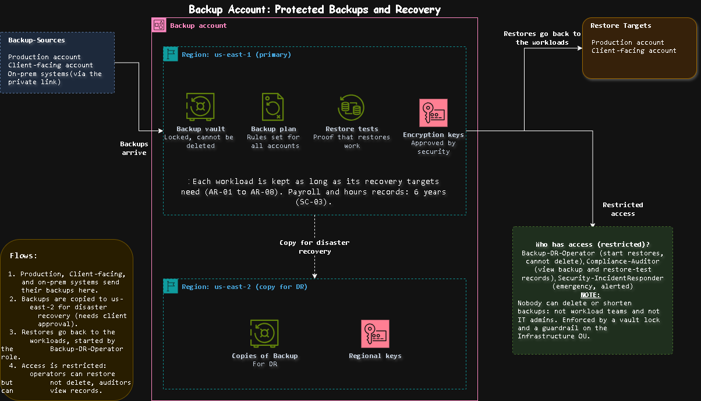

# Backup Account: Protected Backups and Recovery

[Open the sharp SVG version](../architecture-blueprints/svg/backupaccount.svg)

| | |
|---|---|
| **Project** | NY staffing company, multi-account AWS architecture |
| **Account** | Backup (account 5 of 9) |
| **OU** | Infrastructure |
| **Region** | us-east-1 (primary), us-east-2 (copy for DR) |
| **Document status** | Draft for client review |
| **Related documents** | [`01-management-account.md`](./01-management-account.md), [`03-log-archive-account.md`](./03-log-archive-account.md), [`06-production-account.md`](./06-production-account.md), [`requirements.md`](../../requirements.md) |

> [!NOTE]
> **Status labels used in this document**
> - **Confirmed**: stated by the client in the brief
> - **Proposed**: my design choice, to be validated with the client
> - **Needs approval**: a figure or choice the client must sign off

## Contents

1. [Purpose](#1-purpose)
2. [What runs here and what must never run here](#2-what-runs-here-and-what-must-never-run-here)
3. [Architecture](#3-architecture)
4. [Backup plans and retention](#4-backup-plans-and-retention)
5. [Restore testing](#5-restore-testing)
6. [Protection](#6-protection)
7. [Guardrails](#7-guardrails)
8. [Access](#8-access)
9. [Connections](#9-connections)
10. [Requirements covered](#10-requirements-covered)
11. [Decision records](#11-decision-records)
12. [Risks](#12-risks)
13. [Open questions](#13-open-questions)
14. [Review checklist](#14-review-checklist)

---

## 1. Purpose

The Backup account is **where the copies of the client's important data are kept, out of reach of anyone who could damage them**. It exists so that:

- backups survive even if a workload account is compromised (AS-03),
- the business can recover clock in/out, dispatch, and the other workloads within the agreed recovery targets (AR-01 to AR-07),
- the client can prove that backups exist and that restores work (SC-04),
- payroll and hours records are kept for the required six years (SC-03).

> [!IMPORTANT]
> A backup is only worth anything if an attacker or a mistake cannot reach it. That is why backups live in their own account, with a lock that nobody can remove.

## 2. What runs here and what must never run here

| Runs here | Purpose | Requirement | Status |
|---|---|---|---|
| A locked backup vault | Store backups where they cannot be deleted | AS-03 | Proposed |
| Backup plans | One set of rules for how often and how long | AS-03 | Proposed |
| Restore tests | Prove that restores work and how long they take | SC-04, AR-01 | Proposed |
| Encryption keys for the vault | Protect the backups, approved by the Security team | SC-07 | Proposed |
| A second copy of the backups in us-east-2 | Survive a regional failure | AR-10 | Needs approval |

| Must never run here | Where it lives instead | Reason |
|---|---|---|
| Application servers, databases, load balancers | Production, Non-Production, Client-facing | This account holds copies only |
| Logs | Log Archive account | Logs have their own lock and second-region copy (AS-02) |
| Security findings | Security / Audit account | AS-06 |
| Admin and monitoring tools | IT Tooling account | Keeps daily work away from the backups |
| Network connections to on-prem | Network account | Shared connectivity is managed in one place |

**Not backed up here**

| Item | Why |
|---|---|
| Dev and test (Non-Production) | The brief says it is not critical (AR-08), so it is rebuilt from code instead (see ADR-B3) |
| Logs | Protected by the Log Archive lock and copied to us-east-2 there |
| Settings of the Management, Network, and Security accounts | Rebuilt from the documentation and the infrastructure code in the repo |

## 3. Architecture

[Open the sharp SVG version](../architecture-blueprints/05-backup-account.svg)

**Flows**

| # | Flow | Purpose | Requirement |
|---|---|---|---|
| 1 | Production, Client-facing, and on-prem systems send their backups here | One protected home for backups | AS-03 |
| 2 | Backups are copied to us-east-2 | Survive a regional failure | AR-10 |
| 3 | Restores go back to the workloads, started by the `Backup-DR-Operator` role | Recover after a failure | AR-01 to AR-07 |
| 4 | Access is restricted: operators restore but cannot delete, auditors view records | Prove backups exist and cannot be tampered with | SC-04 |

**Components**

| Component | What it does | Status |
|---|---|---|
| Backup vault (us-east-1) | Holds the backups; locked so they cannot be deleted | Proposed |
| Backup plans | Set how often to back up and how long to keep each kind of data | Proposed |
| Restore tests | Regularly restore a backup to prove it works | Proposed |
| Encryption keys (us-east-1) | Protect the stored backups, approved by Security | Proposed |
| Copy of backups (us-east-2) | Disaster recovery copy | Needs approval |
| Regional keys (us-east-2) | Protect the copy in the second region | Needs approval |

## 4. Backup plans and retention

The plans follow the recovery targets from the client brief. A backup protects against **damage, deletion, and corruption**. The very short data-loss limits for clock in/out are met by replication in Production, and backups cover what replication cannot, such as a mistake that is copied to the standby.

| Tier | Workloads | Recovery targets (RTO / RPO) | Backup frequency | Keep for | Status |
|---|---|---|---|---|---|
| 1: Critical | Clock in/out and dashboard, dispatch | 1 to 2 hours / 5 to 15 minutes | Frequent, with point-in-time recovery where the service supports it | 35 days, plus monthly copies for one year | Needs approval |
| 2: Important | Client / building owner portal | 4 hours / 1 hour | Daily | 35 days | Needs approval |
| 3: Standard | Reporting and analytics | 24 hours / 24 hours | Daily | 14 days | Needs approval |
| On-prem records | Payroll and finance, HR records | 8 hours / 1 hour | Daily, if the client approves an AWS copy (see ADR-B4) | 6 years for payroll and hours records (SC-03) | Needs approval |
| Not backed up | Dev and test | Days / not critical (AR-08) | None; rebuilt from code | n/a | Confirmed |

## 5. Restore testing

An untested backup is a guess. Each test leaves a record that doubles as audit evidence (SC-04).

| Test | How often | What it proves | Record kept | Status |
|---|---|---|---|---|
| Restore a critical workload to a test environment | Quarterly | The backup works and the restore time meets the 1-hour target (AR-01) | Date, time taken, result, who ran it | Proposed |
| Restore an important workload | Twice a year | The backup works | Date, result | Proposed |
| Restore from the us-east-2 copy | Once a year | The disaster recovery copy works | Date, time taken, result | Needs approval |
| Full disaster recovery exercise for the critical tier | Once a year | The whole recovery plan works, including the after-hours provider's runbook (AR-11) | Exercise report | Needs approval |

Restores are started from this account by the `Backup-DR-Operator` role and land in a **test environment**, never over the live system, unless the situation is a real recovery.

## 6. Protection

| Protection | How it helps | Requirement | Status |
|---|---|---|---|
| Vault lock | Backups cannot be deleted or shortened until the retention period ends | AS-03 | Needs approval (see ADR-B2) |
| Backups held in a different account from the source | A compromised workload account cannot reach them | AS-03 | Proposed |
| Rules set from the Management account | Workload teams cannot switch backups off or change their schedule | AS-03 | Proposed |
| Encryption with keys approved by the Security team | Backups are unreadable without approved key access | SC-07 | Proposed |
| Deletion protection on the keys | A deleted key would make the backups unreadable, so key deletion is blocked and delayed | SC-07 | Proposed |
| Copy in a second region | Survives a regional failure | AR-10 | Needs approval |
| Public access blocked | No backup can be shared outside the organization | SC-01 | Proposed |
| Alerts on any change to backup settings | Immediate notice of tampering attempts | SC-09 | Proposed |

## 7. Guardrails

Rules attached to the Infrastructure OU, in addition to the ones inherited from the Root. They apply whatever permissions a person holds in this account.

| # | Guardrail | Attached to | Purpose | Requirement | Status |
|---|---|---|---|---|---|
| 1 | Deny deleting backups or shortening their retention | Infrastructure OU | Backups survive an attack or a mistake | AS-03 | Proposed |
| 2 | Deny removing the vault lock | Infrastructure OU | The lock cannot be switched off | AS-03 | Proposed |
| 3 | Deny sharing backups outside the organization | Infrastructure OU | Backups stay inside | SC-01 | Proposed |
| 4 | Deny changing or removing backup plans in member accounts | Root | Workload teams cannot opt out | AS-03 | Proposed |
| 5 | Deny any region except us-east-1 and us-east-2 | Root (inherited) | Keeps backups in approved US regions | SC-01 | Proposed |

## 8. Access

Few people sign in here, and none of them can delete a backup.

| Permission set | Who | Purpose | Access in Backup | Key control | Status |
|---|---|---|---|---|---|
| `Backup-DR-Operator` | Backup team | Restore systems after a failure | Start restores into test or production; cannot delete backups or change the lock | Restores logged; alert on every use | Proposed |
| `Compliance-Auditor` | Internal and external auditors | Gather SOC 2 style evidence | View backup and restore-test records, read-only | Time-boxed for audits (SC-04) | Confirmed |
| `Security-IncidentResponder` | Security responders | Investigate an incident | Emergency read access | Limited to hours, reason recorded, alert on every use | Proposed |
| `Security-KeyApprovers` | Named security staff | Approve use of the vault keys | Approve key policy changes; no access to the backups | Two approvers for key changes (SC-07) | Proposed |
| `Org-Admin` | Two or three named senior IT staff | Change backup rules across the organization | Account-level settings only; cannot delete backups | Two-person approval; alert on use | Proposed |

**Who has no access:** workload teams, IT operations staff, database administrators, field employees, supervisors, and all external parties including the after-hours provider (IR-02, IR-06). Nobody holds delete rights, including administrators.

| Control | Purpose | Requirement |
|---|---|---|
| Sign in through IAM Identity Center, with Active Directory as the source | One set of accounts | IR-01 |
| MFA on every sign-in | Protect against stolen passwords | IR-02 |
| No long-lived IAM users and no standing admin rights | Remove permanent keys that can leak | IR-04 |
| Root user held under dual control, used only in emergencies | Protect the most powerful identity | IR-05 |
| Access reviewed every quarter | Catch roles that are no longer needed | SC-04 |

## 9. Connections

| # | Connects to | Direction | Purpose | Path | Requirement |
|---|---|---|---|---|---|
| 1 | Production account | Backups in, restores out | Protect and recover the live systems | Account to account, never over the internet | AS-03 |
| 2 | Client-facing account | Backups in, restores out | Protect and recover the owner portal | Account to account | AS-03 |
| 3 | On-prem systems (payroll, HR) | Backups in | Off-site copy of records that stay on-prem | Private link through the Network account (if approved) | WP-08, WP-09 |
| 4 | us-east-2 | Copy out | Disaster recovery | Region to region, encrypted | AR-10 |
| 5 | Log Archive account | Findings and settings logged | Evidence that no one touched the backups | Account to account | AS-02 |

Backup has **no connection to the internet**. The on-prem connection exists only if the client approves an AWS copy of payroll and HR data (see ADR-B4).

## 10. Requirements covered

AS-03, AR-01 to AR-08, AR-10, AR-11, SC-01, SC-03, SC-04, SC-07, SC-09, IR-01, IR-02, IR-04 to IR-06, WP-08, WP-09.

## 11. Decision records

| ID | Decision | Options considered | Decision | Status |
|---|---|---|---|---|
| ADR-B1 | Separate account for backups | Keep backups in each account, or one dedicated account | One dedicated account, so a compromised workload account cannot reach them | Proposed |
| ADR-B2 | How the vault is locked | A lock that a few people can override, or a strict lock that nobody can override until the period ends | Strict lock, because it gives the strongest protection against attack. It cannot be undone by mistake, so the client must approve | Needs approval |
| ADR-B3 | Dev and test | Back up, or rebuild from code | Rebuild from code, because the brief says it is not critical (AR-08) and backups would add cost | Confirmed |
| ADR-B4 | An AWS copy of payroll and HR data | Keep protection on-prem only, or send a copy to AWS | Send a copy only if the client approves, because it moves sensitive data and needs a private-link bandwidth check (CR-04) | Needs approval |
| ADR-B5 | Copy to a second region | Copy everything, copy only the critical tier, or no copy | Copy the critical tier first, and extend if the client wants more | Needs approval |

## 12. Risks

| Risk | Impact | Mitigation |
|---|---|---|
| Restores are never tested | Backups turn out to be unusable in a real emergency | Quarterly tests with a record kept, and an annual full exercise |
| A strict lock is applied with the wrong retention period | Backups cannot be removed when they should be, and the client pays to store them | Confirm the periods with the client before turning the lock on; test with a short period first |
| A backup key is deleted | Stored backups become unreadable | Deletion protection and a long waiting period on the keys; a key copy in us-east-2 |
| On-prem backups use too much of the private link | Slows clock in/out and payroll traffic | Check the bandwidth first (CR-04) and schedule backups outside working hours |
| Corruption is copied into every backup | No clean copy to restore | Keep enough history to go back, plus monthly copies for the critical tier |
| Storage cost grows faster than expected | Surprise bill for the client | Retention tiers, monthly cost review, and budget alerts (CT-01) |

## 13. Open questions

| ID | Question | Why it matters |
|---|---|---|
| OQ-B1 | Are the retention periods in section 4 acceptable? | A lock cannot be shortened once applied |
| OQ-B2 | Should payroll and HR data get an AWS copy at all? | Decides the on-prem connection and the bandwidth need |
| OQ-B3 | How much bandwidth can on-prem backups use? | Affects the private link and its cost (CR-04) |
| OQ-B4 | Who runs the quarterly restore tests and signs them off? | Tests need an owner to count as evidence |
| OQ-B5 | Which lock style does the client approve? | Decides whether anyone can ever remove backups early |

## 14. Review checklist

- [ ] The diagram and this document show the same components and arrows
- [ ] The retention table matches the recovery targets in `requirements.md` and SC-03
- [ ] Every row traces to at least one requirement ID
- [ ] The permission sets match the access profiles in the access control requirements
- [ ] ADR-B2, ADR-B4, and ADR-B5 are agreed with the client before anything is built
- [ ] The guardrails here are added to the Management account's guardrail list
- [ ] Open questions OQ-B1 to OQ-B5 are added to the central list in `requirements.md`

## Change log

| Version | Date | Author | Change |
|---|---|---|---|
| 0.1 | 2026-10-23 | | First draft |
