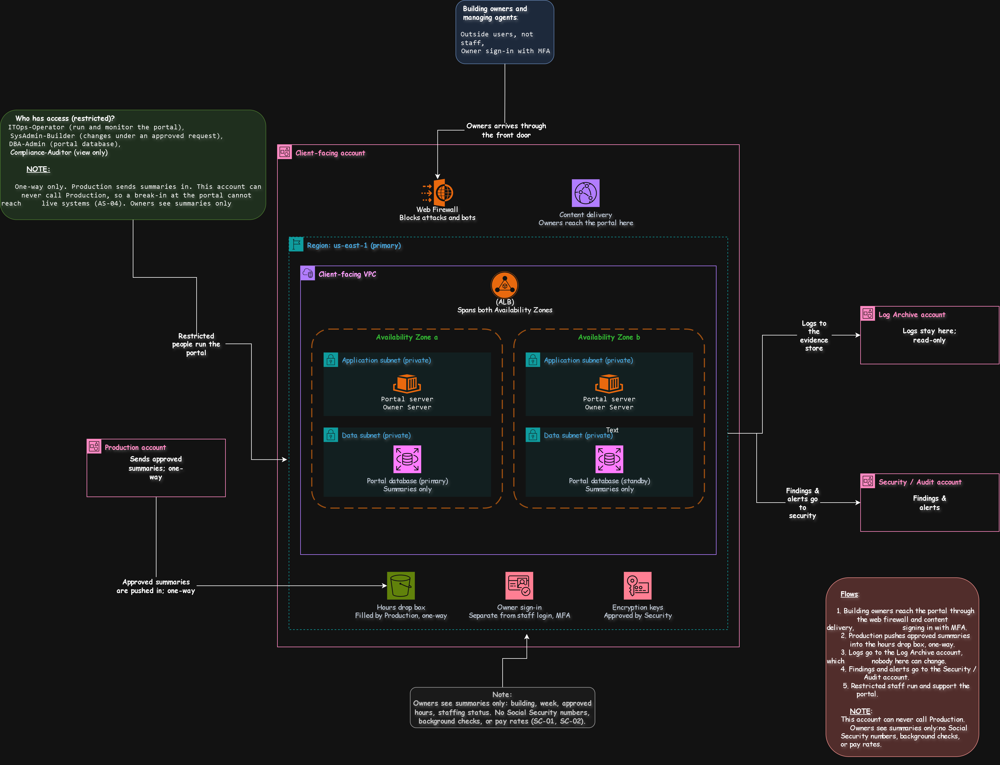

# Client-Facing Account: Owner Portal, Kept Apart from Live Systems

[Open the sharp SVG version](../architecture-blueprints/svg/clientfaingaccount.svg)
| | |
|---|---|
| **Project** | NY staffing company, multi-account AWS architecture |
| **Account** | Client-facing (account 8 of 9) |
| **OU** | Workloads > Production |
| **Region** | us-east-1 |
| **Document status** | Draft for client review |
| **Related documents** | [`01-management-account.md`](./01-management-account.md), [`05-backup-account.md`](./05-backup-account.md), [`06-production-account.md`](./06-production-account.md), [`06-production-account-access.md`](./06-production-account-access.md), [`requirements.md`](../../requirements.md) |

> [!NOTE]
> **Status labels used in this document**
> - **Confirmed**: stated by the client in the brief
> - **Proposed**: my design choice, to be validated with the client
> - **Needs approval**: a figure or choice the client must sign off

## Contents

1. [Purpose](#1-purpose)
2. [What runs here and what must never run here](#2-what-runs-here-and-what-must-never-run-here)
3. [Architecture](#3-architecture)
4. [The one-way rule](#4-the-one-way-rule)
5. [What owners can see](#5-what-owners-can-see)
6. [Owner sign-in](#6-owner-sign-in)
7. [Protection and resilience](#7-protection-and-resilience)
8. [Guardrails](#8-guardrails)
9. [Access](#9-access)
10. [Connections](#10-connections)
11. [Requirements covered](#11-requirements-covered)
12. [Decision records](#12-decision-records)
13. [Risks](#13-risks)
14. [Open questions](#14-open-questions)
15. [Review checklist](#15-review-checklist)

---

## 1. Purpose

The Client-facing account runs the **portal that building owners and managing agents use**, and keeps it completely apart from the systems that run the business. It exists so that:

- outside users are separated from internal systems (AS-04),
- a break-in at the portal cannot reach live staffing, payroll, or HR systems (AS-01, AS-04),
- building owners can see accurate hours and staffing status (BR-01, WP-05),
- owners only ever see what they need, and never employee personal data (SC-01, SC-02).

> [!IMPORTANT]
> Of all nine accounts, this one faces the public internet and is used by people outside the company. That is why it holds **summaries only**, has no path into Production, and gets its own sign-in for owners.

## 2. What runs here and what must never run here

| Runs here | Purpose | Requirement | Status |
|---|---|---|---|
| Web firewall | Block attacks and bots before they reach the portal | SC-08 | Proposed |
| Content delivery | The front door for owners, with the firewall in front | AS-04 | Proposed |
| Application load balancer across two Availability Zones | Spread owner traffic and survive a zone failure | AR-03 | Proposed |
| Portal servers (Windows) | Run the owner portal | WP-05 | Confirmed |
| Portal database with a standby | Store summaries only | WP-05, AR-03 | Proposed |
| Owner sign-in | A separate login for people outside the company, with MFA | IR-02 | Needs approval |
| Hours drop box | The one-way place where Production leaves approved summaries | AS-04 | Proposed |
| Encryption keys | Protect the stored summaries, approved by the Security team | SC-07 | Proposed |

| Must never run here | Where it lives instead | Reason |
|---|---|---|
| Clock in/out and dispatch | Production | Staff systems stay behind their own front door |
| Employee personal data, background checks, pay rates | On-prem, or Production where approved | Owners never see them (SC-01, SC-02) |
| A connection to Production or to on-prem | Not allowed | One-way only (see section 4) |
| Backups | Backup account | AS-03 |
| Logs | Log Archive account | AS-02 |
| Staff sign-in through Active Directory | Production | This account serves outside users only |

## 3. Architecture

[Open the sharp SVG version](../architecture-blueprints/08-client-facing-account.svg)

**Flows**

| # | Flow | Purpose | Requirement |
|---|---|---|---|
| 1 | Building owners reach the portal through the web firewall and content delivery, signing in with MFA | Safe access for outside users | AS-04, IR-02 |
| 2 | Production pushes approved summaries into the hours drop box, one-way | Owners see up-to-date hours without any link to live systems | AS-04 |
| 3 | Logs go to the Log Archive account, which nobody here can change | Evidence | AS-02 |
| 4 | Findings and alerts go to the Security / Audit account | Central security review | SC-09 |
| 5 | Restricted staff run and support the portal | Keep it running | CT-04 |

**Components**

| Component | What it does | Status |
|---|---|---|
| Web firewall | Filters bad traffic, with limits on repeated requests | Proposed |
| Content delivery | Sits in front of the portal and hides the servers behind it | Proposed |
| Application load balancer | Spreads traffic across both zones | Proposed |
| Portal servers (one per zone) | Run the owner portal | Proposed |
| Portal database (primary and standby) | Holds summaries only | Proposed |
| Owner sign-in | Separate from staff login, MFA required | Needs approval |
| Hours drop box | Receives summaries from Production; the portal reads from it | Proposed |
| Encryption keys | Protect stored summaries | Proposed |

## 4. The one-way rule

| Rule | Why | Requirement | Status |
|---|---|---|---|
| Production **pushes** summaries into the drop box. This account can **never call** Production | The only path runs outward, so a break-in at the portal cannot reach live systems | AS-04 | Proposed |
| No shared network, no cross-account roles into Production | Nothing to climb through | AS-01 | Proposed |
| The drop box accepts writes only from Production's feed role | Nobody else can inject data | AS-02 | Proposed |
| The feed runs on a schedule and every run is logged | Evidence of what was shared and when | AS-02, SC-04 | Proposed |
| If the feed stops, the portal shows the time of the last update | Owners are never given stale hours as if they were live | BR-01 | Proposed |

## 5. What owners can see

| Owners can see | Owners can never see |
|---|---|
| Building and week | Social Security numbers |
| Approved hours | Background check results |
| Staffing status (for example, covered or uncovered) | Pay rates and payroll data |
| The time of the last update | Employee home addresses and personal contact details |

Whether owners may see **worker names** is an open question (OQ-C2). The safe default is roles and counts only, with no names.

## 6. Owner sign-in

Building owners are not employees, so they cannot use Active Directory. This is a deliberate **exception to IR-01**, and it must be approved by the client.

| Control | Detail | Requirement | Status |
|---|---|---|---|
| A separate user directory for owners | Never mixed with staff accounts | AS-04, IR-01 | Needs approval |
| MFA required on every sign-in | Protect against stolen passwords | IR-02 | Proposed |
| Strong password rules and lock-out after repeated failures | Block guessing attacks | IR-02 | Proposed |
| Accounts created on request by named client staff, and removed when a building contract ends | No forgotten outside users | IR-06 | Proposed |
| Every owner sign-in logged | Evidence for building owners and auditors | SC-04 | Proposed |
| Alerts on unusual sign-ins | Early warning of account takeover | SC-09 | Proposed |

## 7. Protection and resilience

| Protection | How it helps | Requirement | Status |
|---|---|---|---|
| Web firewall in front of the portal | Blocks common attacks and bots | SC-08 | Proposed |
| Servers and database have no public addresses | Only the front door is reachable | AS-04 | Proposed |
| Encryption in transit and at rest, with keys approved by Security | Summaries are unreadable if stolen | SC-07 | Proposed |
| Portal and database in two Availability Zones | Survives the loss of one zone | AR-03 | Proposed |
| Daily backups to the Backup account, kept 35 days | Recover from deletion or corruption (Tier 2 in the Backup file) | AR-03, AS-03 | Needs approval |
| Restore tests twice a year | Proves the 4-hour target can be met | AR-03 | Proposed |
| No copy in us-east-2 | The portal is not in the critical tier (AR-10), so a regional failure means a rebuild from backups, which may exceed 4 hours | AR-03, AR-10 | Needs approval |

## 8. Guardrails

Rules attached to this account, in addition to the ones inherited from the Root and the Production OU.

| # | Guardrail | Attached to | Purpose | Requirement | Status |
|---|---|---|---|---|---|
| 1 | Deny assuming roles in, or sharing data with, any other Production OU account except the drop box write | This account | Keeps the one-way rule real, even though both accounts share an OU | AS-04 | Proposed |
| 2 | Deny connecting to the shared network | This account | No path to Production or on-prem | AS-01 | Proposed |
| 3 | Deny public addresses on servers and databases | This account | Only the front door is reachable | AS-04 | Proposed |
| 4 | Deny unencrypted storage | Production OU (inherited) | Encryption everywhere | SC-07 | Proposed |
| 5 | Deny public access to storage | Production OU (inherited) | Protects owner and employee data | SC-01 | Proposed |
| 6 | Deny stopping or deleting CloudTrail, Config, and GuardDuty | Root (inherited) | Detection stays on | SC-08 | Proposed |
| 7 | Deny any region except us-east-1 and us-east-2 | Root (inherited) | Keeps data in approved US regions | SC-01 | Proposed |

## 9. Access

Staff access only. Owners sign in to the portal, not to AWS.

| Permission set | Who | Purpose | Access in Client-facing | Key control | Status |
|---|---|---|---|---|---|
| `ITOps-Operator` | IT operations staff | Run and monitor the portal | Monitor, restart services, patch in approved windows; cannot create or delete core resources | MFA, actions logged | Proposed |
| `SysAdmin-Builder` | Senior system administrators | Change the portal | Changes under an approved change request | Per-change approval; no changes at payroll quarter-end or tax periods (CT-03) | Proposed |
| `DBA-Admin` | Database administrators | Look after the portal database | Administer the database; holds summaries only | Actions logged | Proposed |
| `Compliance-Auditor` | Internal and external auditors | Gather SOC 2 style evidence | View-only | Time-boxed for audits (SC-04) | Confirmed |
| `Backup-DR-Operator` | Backup team | Restore the portal | Start restores from the Backup account; cannot delete backups | Restores logged | Proposed |
| `Security-KeyApprovers` | Named security staff | Approve use of the portal keys | Approve key policy changes; no access to the data | Two approvers for key changes (SC-07) | Proposed |
| `Org-Admin` | Two or three named senior IT staff | Change account-level settings | Account-level settings only | Two-person approval; alert on use | Proposed |

**Who has no access to AWS here:** building owners and managing agents (they use the portal only), field employees, supervisors, back-office staff, and all external parties (IR-02, IR-06). Whether the after-hours provider should have runbook-only actions for the portal is an open question (OQ-C3).

| Control | Purpose | Requirement |
|---|---|---|
| Sign in through IAM Identity Center, with Active Directory as the source | One set of staff accounts | IR-01 |
| MFA on every sign-in | Protect against stolen passwords | IR-02 |
| No long-lived IAM users and no standing admin rights | Remove permanent keys that can leak | IR-04 |
| Root user held under dual control, used only in emergencies | Protect the most powerful identity | IR-05 |
| Access reviewed every quarter | Catch roles that are no longer needed | SC-04 |

## 10. Connections

| # | Connects to | Direction | Purpose | Path | Requirement |
|---|---|---|---|---|---|
| 1 | Building owners and managing agents | Access in | Use the portal | Internet, through the web firewall and content delivery | AS-04 |
| 2 | Production account | Summaries in, one-way | Fill the hours drop box | Production pushes to the drop box; this account never calls out | AS-04 |
| 3 | Log Archive account | Logs out | Evidence | Account to account | AS-02 |
| 4 | Security / Audit account | Findings out | Central security review | Account to account | SC-09 |
| 5 | Staff (restricted) | Access in | Run the portal | Through IAM Identity Center | IR-01 |
| 6 | Backup account | Backups out, restores in | Protect and recover the portal | Account to account | AS-03 |

Row 6 is covered by flow 1 in the [Backup document](./05-backup-account.md), where this account is one of the sources.

Client-facing has **no connection to on-prem and none to the shared network**. The only inbound path from the company's systems is the one-way hours feed.

## 11. Requirements covered

AS-01 to AS-04, AR-03, AR-10, BR-01, CT-03, CT-04, WP-05, SC-01, SC-02, SC-04, SC-07 to SC-09, IR-01, IR-02, IR-04 to IR-06.

## 12. Decision records

| ID | Decision | Options considered | Decision | Status |
|---|---|---|---|---|
| ADR-C1 | Separate account for outside users | Run the portal in Production, or in its own account | Its own account, so a break-in at the portal cannot reach live systems | Proposed |
| ADR-C2 | How hours reach the portal | The portal pulls from Production, Production pushes to a drop box, or a shared database | Production pushes to a drop box, one-way (settles OQ-P4) | Proposed |
| ADR-C3 | How owners sign in | Active Directory accounts, a separate owner directory, or a shared password | A separate owner directory with MFA, as a justified exception to IR-01 | Needs approval |
| ADR-C4 | How field employees reach clock in/out | Through this account, through Production's own front door, or private paths only | Production's own front door, with a firewall layer and AD login with MFA (settles OQ-P1). This account serves building owners only | Proposed |
| ADR-C5 | What owners may see | Full records, or summaries only | Summaries only: building, week, approved hours, staffing status (SC-01, SC-02) | Proposed |
| ADR-C6 | Resilience level | Critical-tier design with a second region, or two zones with backups | Two zones with backups, because the portal's recovery targets are 4 hours and 1 hour (AR-03) | Needs approval |

## 13. Risks

| Risk | Impact | Mitigation |
|---|---|---|
| An owner's account is taken over | Someone sees another building's hours | MFA, lock-out, alerts on unusual sign-ins, and each owner sees only their own buildings |
| The portal is attacked from the internet | Outage or defacement | Web firewall, no public addresses on servers, and monitoring in the Security / Audit account |
| Someone later adds a connection to Production "for convenience" | The separation fails | Guardrails 1 and 2, and a quarterly review of the account's connections |
| Too much data is placed in the drop box | Owners see employee personal data | A fixed list of allowed fields, a check when the feed is built, and a quarterly review |
| A regional failure takes longer than 4 hours to recover | Owners cannot reach the portal | Agree the target with the client, or add a copy in us-east-2 if they want it |
| The feed stops without anyone noticing | Owners see stale hours | The portal shows the time of the last update, and alerts if the feed misses a run |

## 14. Open questions

| ID | Question | Why it matters |
|---|---|---|
| OQ-C1 | Who creates and removes owner accounts, and how fast? | Needed to keep the outside user list accurate |
| OQ-C2 | Do owners see worker names, or only roles and counts? | Decides what personal data enters this account |
| OQ-C3 | Should the after-hours provider have runbook-only actions for the portal? | Decides the access table and the after-hours runbook |
| OQ-C4 | How often should the hours feed run? | Sets how fresh the data is |
| OQ-C5 | Is a recovery time of more than 4 hours after a regional failure acceptable for the portal? | Decides whether a us-east-2 copy is needed |

## 15. Review checklist

- [ ] The diagram and this document show the same components and arrows
- [ ] No arrow or connection runs from this account to Production
- [ ] The owner sign-in exception to IR-01 is approved by the client
- [ ] Every row traces to at least one requirement ID
- [ ] The permission sets match the access profiles in the access control requirements
- [ ] The Production files are updated for ADR-C2 and ADR-C4
- [ ] The guardrails here are added to the Management account's guardrail list
- [ ] Open questions OQ-C1 to OQ-C5 are added to the central list in `requirements.md`

## Change log

| Version | Date | Author | Change |
|---|---|---|---|
| 0.1 | 2026-10-23 | | First draft |
