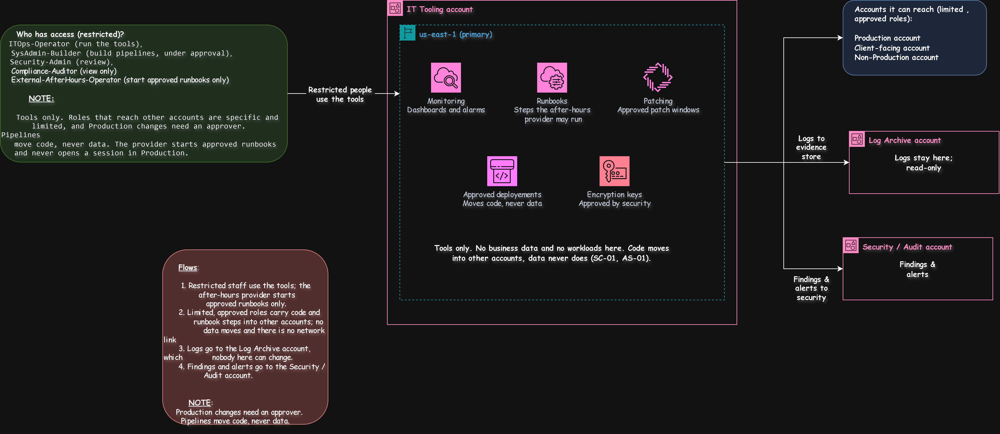

# IT Tooling Account: Monitoring, Runbooks, and Approved Deployments

[Open the sharp SVG version](../architecture-blueprints/svg/it-toolingaccount.svg)
| | |
|---|---|
| **Project** | NY staffing company, multi-account AWS architecture |
| **Account** | IT Tooling (account 9 of 9) |
| **OU** | Infrastructure |
| **Region** | us-east-1 |
| **Document status** | Draft for client review |
| **Related documents** | [`01-management-account.md`](./01-management-account.md), [`02-security-audit-account.md`](./02-security-audit-account.md), [`06-production-account-access.md`](./06-production-account-access.md), [`07-non-production-account.md`](./07-non-production-account.md), [`requirements.md`](../../requirements.md) |

> [!NOTE]
> **Status labels used in this document**
> - **Confirmed**: stated by the client in the brief or in discussion with the client
> - **Proposed**: my design choice, to be validated with the client
> - **Needs approval**: a figure or choice the client must sign off

## Contents

1. [Purpose](#1-purpose)
2. [What runs here and what must never run here](#2-what-runs-here-and-what-must-never-run-here)
3. [Architecture](#3-architecture)
4. [Why a separate account](#4-why-a-separate-account)
5. [The three jobs](#5-the-three-jobs)
6. [Conditions](#6-conditions)
7. [How roles reach other accounts](#7-how-roles-reach-other-accounts)
8. [Guardrails](#8-guardrails)
9. [Access](#9-access)
10. [Connections](#10-connections)
11. [Review after wave 1](#11-review-after-wave-1)
12. [Requirements covered](#12-requirements-covered)
13. [Decision records](#13-decision-records)
14. [Risks](#14-risks)
15. [Open questions](#15-open-questions)
16. [Review checklist](#16-review-checklist)

---

## 1. Purpose

The IT Tooling account is **where the small IT team keeps the tools that watch, patch, and change the other accounts**. It exists so that:

- the day team and the after-hours provider see the same picture (AR-11),
- patching and approved changes follow one set of steps, instead of each person building their own tools in each account (CT-04),
- the after-hours provider can run approved steps without being given open access to live systems (AR-11),
- the tools that can reach Production are kept away from live data and away from the lighter rules of dev and test (AS-01).

> [!IMPORTANT]
> This account is **small and strict on purpose**. It holds tools and nothing else. If a tool does not do one of the three jobs in section 5, it does not belong here without the client's approval.

## 2. What runs here and what must never run here

| Runs here | Purpose | Requirement | Status |
|---|---|---|---|
| Monitoring (dashboards and alarms) | One view of how every account is doing | AR-11 | Confirmed |
| Runbooks | The approved steps the after-hours provider may start | AR-11 | Confirmed |
| Patching | Approved patch windows for the servers | CT-03 | Confirmed |
| Approved deployments | The route a tested change takes into other accounts | CT-03 | Confirmed |
| Encryption keys for the tools | Protect tool settings and deployment records, approved by the Security team | SC-07 | Proposed |

| Must never run here | Where it lives instead | Reason |
|---|---|---|
| Business data, such as employee records or owner summaries | On-prem, Production, Client-facing | SC-01 |
| Workloads, servers, or databases | Production, Non-Production, Client-facing | Tools only |
| Logs | Log Archive account | AS-02 |
| Backups | Backup account | AS-03 |
| Security findings and detection | Security / Audit account | AS-06 |
| Network connections to on-prem | Network account | Shared connectivity is managed in one place |

## 3. Architecture

[Open the sharp SVG version](../architecture-blueprints/09-it-tooling-account.svg)

**Flows**

| # | Flow | Purpose | Requirement |
|---|---|---|---|
| 1 | Restricted staff use the tools; the after-hours provider starts approved runbooks only | Day and night coverage with limited access | AR-11 |
| 2 | Limited, approved roles carry code and runbook steps into other accounts. No data moves and there is no network link | Controlled changes | CT-03, AS-01 |
| 3 | Logs go to the Log Archive account, which nobody here can change | Evidence | AS-02 |
| 4 | Findings and alerts go to the Security / Audit account | Central security review | SC-09 |

**Components**

| Component | What it does | Status |
|---|---|---|
| Monitoring | Dashboards and alarms across the accounts, read-only | Proposed |
| Runbooks | Written steps that a person or the provider can start with one action | Proposed |
| Patching | Applies updates to servers in approved windows | Proposed |
| Approved deployments | A pipeline that moves tested code into other accounts, with an approval step | Proposed |
| Encryption keys | Protect tool settings and deployment records | Proposed |

## 4. Why a separate account

| Option considered | Verdict | Reason |
|---|---|---|
| Merge into Production | Rejected | Admin tools with wide reach would sit beside live systems, so one mistake or compromise has a bigger blast radius |
| Merge into the Network account | Rejected | That account should stay tiny and highly trusted, because it holds the only link to the office and the data centers |
| Merge into Non-Production | Rejected | Its rules are lighter on purpose, and tools that can reach Production should not live under light rules |
| Merge into the Management account | Rejected | Nothing runs there, because guardrails do not apply to it (SC-08) |
| Keep a separate account, small and strict | **Chosen** | Keeps the reach of the tools in one place that can be watched closely |

## 5. The three jobs

| Job | What it means | Examples | Requirement | Status |
|---|---|---|---|---|
| Monitoring | Dashboards and alarms across the accounts, so the day team and the provider see the same picture | Clock in/out availability, dispatch health, portal health | AR-01 to AR-03, AR-11 | Confirmed |
| Patching and runbooks | The approved steps the provider may run, and the client's patch windows | Restart a service, check load balancer health, collect diagnostics for the morning team | AR-11, CT-03 | Confirmed |
| Approved deployments | The route a tested change takes into other accounts | A change built and tested in Non-Production, approved, then applied to Production | CT-03 | Confirmed |

> [!NOTE]
> **Operational alerts versus security alerts.** Alerts about outages and health are handled here. Alerts about attacks and misuse are handled in the [Security / Audit account](./02-security-audit-account.md).

**Runbooks, in practice**

| Runbook (examples) | Who may start it | Status |
|---|---|---|
| Restart the clock in/out service | The day team, and the provider overnight | Needs approval |
| Check load balancer and server health, and report | The day team, and the provider overnight | Needs approval |
| Collect diagnostics and save them for the morning team | The day team, and the provider overnight | Needs approval |
| Contact the named on-call contact | The provider | Needs approval |

Each runbook is approved by the client before it goes live. Restoring from backup is **not** a runbook for the provider: it belongs to the `Backup-DR-Operator` role in the Backup account.

**Patching**

| Rule | Purpose | Requirement | Status |
|---|---|---|---|
| Patches are tested in Non-Production first | Catch problems before they reach live systems | CT-03 | Proposed |
| Production patches run only in approved windows | Predictable change | CT-03 | Needs approval |
| No patching at payroll quarter-end or tax periods | Protect payroll processing | CT-03 | Confirmed |
| A record of what was patched and when | Evidence for building owners | SC-04 | Proposed |

## 6. Conditions

These come from the client's discussion of why the account exists, and each one is part of the design.

| # | Condition | How it is met | Status |
|---|---|---|---|
| 1 | No business data, no workloads | Guardrail denies servers and databases; the tools are managed services | Confirmed |
| 2 | Treated like Security: few people, MFA, every action logged, alerts on powerful roles | Access table and alerts in section 9 | Confirmed |
| 3 | Reach into other accounts is limited and approved | Specific roles with narrow permissions; Production changes need an approver (section 7) | Confirmed |
| 4 | The provider gets runbooks, not open access | A narrow permission set that can only start approved runbooks | Confirmed |
| 5 | Review after wave 1 | See section 11 | Confirmed |
| 6 | Keep the cost small | Managed services only, no servers, budget alert (CT-01) | Confirmed |

## 7. How roles reach other accounts

IT Tooling has **no network link** to other accounts. It reaches them only through specific roles that the other account allows, and each role can do one narrow thing.

| Role | Does what | Cannot do | Approval | Requirement | Status |
|---|---|---|---|---|---|
| Monitoring role | Read health and performance numbers | Read business data or change anything | None | AR-11 | Proposed |
| Runbook role | Run one approved step, such as a restart | Open a session, read data, or run anything not on the approved list | The client approves each runbook once | AR-11 | Proposed |
| Patching role | Apply approved updates in a window | Install anything else | Approved windows | CT-03 | Proposed |
| Deployment role | Apply a tested change | Read business data; deploy outside an approved window | An approver who is **not** the builder, for Production and Client-facing | CT-03 | Needs approval |

| Rule | Why | Requirement |
|---|---|---|
| The person who builds a change cannot approve it | Separation of duties | AS-06 |
| Pipelines move code, never data | Business data must not enter this account | SC-01 |
| Production deployments are blocked during payroll quarter-end and tax periods | Protect payroll processing | CT-03 |
| Every use of a role is logged, and powerful roles raise an alert | Evidence and early warning | AS-02, SC-09 |
| Roles are time-limited where possible | Reduces what an attacker could do with a stolen session | IR-04 |

## 8. Guardrails

Rules attached to this account, in addition to the ones inherited from the Root and the Infrastructure OU. They apply whatever permissions a person holds in this account.

| # | Guardrail | Attached to | Purpose | Requirement | Status |
|---|---|---|---|---|---|
| 1 | Deny creating servers and databases | This account | Keeps it tools-only | AS-05, SC-01 | Proposed |
| 2 | Deny connecting to the shared network | This account | No network link to other accounts or to on-prem | AS-01 | Proposed |
| 3 | Deny changes to the roles that reach other accounts, except by two approved administrators | This account | The reach of the tools cannot grow quietly | AS-06 | Proposed |
| 4 | Deny public access to storage | This account | Tool settings and deployment records stay private | SC-01 | Proposed |
| 5 | Deny stopping or deleting CloudTrail, Config, and GuardDuty | Root (inherited) | Detection stays on | SC-08 | Proposed |
| 6 | Deny any region except us-east-1 and us-east-2 | Root (inherited) | Keeps tools in approved US regions | SC-01 | Proposed |

## 9. Access

Few people sign in here, and none of them can read business data through it.

| Permission set | Who | Purpose | Access in IT Tooling | Key control | Status |
|---|---|---|---|---|---|
| `ITOps-Operator` | IT operations staff | Run the tools | View dashboards, start approved runbooks, apply approved patching | MFA, actions logged | Proposed |
| `SysAdmin-Builder` | Senior system administrators | Build and change the pipelines | Build pipelines and runbooks under approval; cannot approve their own Production changes | Per-change approval (CT-03) | Proposed |
| `Security-Admin` | Security team | Review the tools and their reach | Read access; review roles and logs | Reads, never writes | Proposed |
| `Compliance-Auditor` | Internal and external auditors | Gather SOC 2 style evidence | View-only | Time-boxed for audits (SC-04) | Confirmed |
| `External-AfterHours-Operator` | After-hours IT provider | Cover nights and weekends | Start approved runbooks only; no open session, no console access to other accounts | Runbook-only, session logged, alert on every use (AR-11) | Confirmed |
| `Security-KeyApprovers` | Named security staff | Approve use of the tool keys | Approve key policy changes; no access to settings | Two approvers for key changes (SC-07) | Proposed |
| `Org-Admin` | Two or three named senior IT staff | Change account-level settings | Account-level settings only | Two-person approval; alert on use | Proposed |

**Who has no access:** field employees, supervisors, back-office staff, database administrators, backup staff, building owners, and all other external parties (IR-02, IR-06).

> [!NOTE]
> The Production access table gives `External-AfterHours-Operator` "runbook actions only, with no open shell." That is delivered **through this account**: the provider starts an approved runbook here, and the runbook role in Production does the one step.

| Control | Purpose | Requirement |
|---|---|---|
| Sign in through IAM Identity Center, with Active Directory as the source | One set of accounts | IR-01 |
| MFA on every sign-in | Protect against stolen passwords | IR-02 |
| No long-lived IAM users and no standing admin rights | Remove permanent keys that can leak | IR-04 |
| Root user held under dual control, used only in emergencies | Protect the most powerful identity | IR-05 |
| External access expires automatically | No forgotten vendor access | IR-06 |
| Alerts on use of the powerful roles | Early warning of misuse | SC-09 |
| Access reviewed every quarter | Catch roles that are no longer needed | SC-04 |

## 10. Connections

| # | Connects to | Direction | Purpose | Path | Requirement |
|---|---|---|---|---|---|
| 1 | Restricted staff and the after-hours provider | Access in | Use the tools | Through IAM Identity Center | IR-01 |
| 2 | Production, Client-facing, Non-Production | Roles out | Monitoring, runbook steps, patching, approved deployments | Specific roles only; no network link | CT-03, AS-01 |
| 3 | Log Archive account | Logs out | Evidence | Account to account | AS-02 |
| 4 | Security / Audit account | Findings out | Central security review | Account to account | SC-09 |

IT Tooling has **no connection to on-prem, no network link to any account, and no route to business data.** The roles in row 2 are the only reach it has.

## 11. Review after wave 1

The account stays only if it earns its place. After wave 1, the client reviews it against these questions.

| Question | If the answer is no |
|---|---|
| Is the after-hours provider using the runbooks? | Runbooks may not need a separate account |
| Are tested changes reaching Production through the pipeline? | The pipeline may not need a separate account |
| Do the day team and the provider use the dashboards? | Dashboards may not need a separate account |
| Has the account stayed tools-only, with no data and no workloads? | Fix it, or close it |
| Is the cost still a small part of the budget? | Reduce the tools |

If the answers show the account is not needed, the remaining tools move into another account and the organization drops to **eight accounts**. Which account would take them is an open question (OQ-T4).

## 12. Requirements covered

AS-01, AS-05, AS-06, AR-01 to AR-03, AR-09, AR-11, CT-01, CT-03, CT-04, SC-01, SC-04, SC-07 to SC-09, IR-01, IR-02, IR-04 to IR-06.

## 13. Decision records

| ID | Decision | Options considered | Decision | Status |
|---|---|---|---|---|
| ADR-T1 | A separate IT Tooling account | Merge into Production, Network, Non-Production, or Management; or keep it separate | Keep it separate, small and strict, with a review after wave 1. This settles ADR-M4 | Confirmed |
| ADR-T2 | How the after-hours provider works | Give them a login in each account, or let them start approved runbooks | Runbooks only, with a narrow permission set and no open session | Confirmed |
| ADR-T3 | How changes reach other accounts | Network links, shared admin access, or limited roles | Limited roles only, with a separate approver for Production and Client-facing | Needs approval |
| ADR-T4 | What the pipelines carry | Code and data, or code only | Code only. Business data never enters this account | Confirmed |
| ADR-T5 | When to review the account | Never, or after wave 1 | After wave 1, against the questions in section 11 | Confirmed |

## 14. Risks

| Risk | Impact | Mitigation |
|---|---|---|
| The account becomes a dumping ground for tools | It grows beyond its three jobs and its guardrails | Anything outside the three jobs needs the client's approval; review after wave 1 |
| A powerful role into Production is misused or stolen | A change or an outage in live systems | Narrow roles, an approver who is not the builder, MFA, alerts on use, and logs the team cannot delete |
| A runbook runs the wrong step overnight | An outage made worse | Each runbook is approved by the client, tested in Non-Production first, and limited to one step |
| A deployment happens during payroll quarter-end | Payroll disruption | Pipelines block Production changes during the agreed blackout periods (CT-03) |
| Monitoring misses an account or region | A blind spot | Check coverage after each wave, and alert when an account stops reporting |
| Cost drifts upward | A surprise on the bill | Managed services only, no servers, and a budget alert (CT-01) |

## 15. Open questions

| ID | Question | Why it matters |
|---|---|---|
| OQ-T1 | Who is the named approver for Production and Client-facing deployments? | Needed so the builder never approves their own change |
| OQ-T2 | Which runbooks does the client approve first? | Needed before the provider can be given any |
| OQ-T3 | What are the patch windows and the payroll blackout calendar? | Needed to set the pipeline rules (CT-03) |
| OQ-T4 | If the account is closed after wave 1, which account takes the tools? | Decides the fallback design |
| OQ-T5 | Should the after-hours provider have read-only dashboards too? | Affects their permission set |

## 16. Review checklist

- [ ] The diagram and this document show the same components, boxes, and arrows
- [ ] There is no network link or arrow to any box that holds business data
- [ ] Every row traces to at least one requirement ID
- [ ] The permission sets match the access profiles in the access control requirements
- [ ] ADR-M4 in the Management file is updated to match ADR-T1
- [ ] The Production access document's row for `External-AfterHours-Operator` matches section 9
- [ ] The guardrails here are added to the Management account's guardrail list
- [ ] Open questions OQ-T1 to OQ-T5 are added to the central list in `requirements.md`

## Change log

| Version | Date | Author | Change |
|---|---|---|---|
| 0.1 | 2026-10-23 | | First draft |
