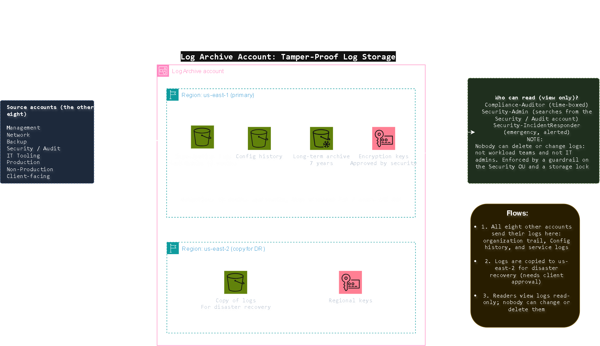

[Open the sharp SVG version](../architecture-blueprints/logarchiveaccount.svg)

# Log Archive Account: Tamper-Proof Log Storage

| | |
|---|---|
| **Project** | NY staffing company, multi-account AWS architecture |
| **Account** | Log Archive (account 3 of 9) |
| **OU** | Security |
| **Region** | us-east-1 (primary), us-east-2 (copy for DR) |
| **Document status** | Draft for client review |
| **Related documents** | [`01-management-account.md`](./01-management-account.md), [`06-production-account.md`](./06-production-account.md), [`requirements.md`](../../requirements.md) |

> [!NOTE]
> **Status labels used in this document**
> - **Confirmed**: stated by the client in the brief
> - **Proposed**: my design choice, to be validated with the client
> - **Needs approval**: a figure or choice the client must sign off

## Contents

1. [Purpose](#1-purpose)
2. [What runs here and what must never run here](#2-what-runs-here-and-what-must-never-run-here)
3. [Architecture](#3-architecture)
4. [Retention](#4-retention)
5. [Protection](#5-protection)
6. [Guardrails](#6-guardrails)
7. [Access](#7-access)
8. [Connections](#8-connections)
9. [Requirements covered](#9-requirements-covered)
10. [Decision records](#10-decision-records)
11. [Risks](#11-risks)
12. [Open questions](#12-open-questions)
13. [Review checklist](#13-review-checklist)

---

## 1. Purpose

The Log Archive account is the **one place where the organization's logs are kept, and where nobody in IT can change or delete them**. It exists so that:

- the client has evidence of who did what in every account (AS-02),
- logs are searchable for 12 months and archived for 7 years (SC-06),
- auditors and building owners can be shown SOC 2 style evidence (SC-04),
- access to employee personal data and background check records can be proven and reviewed (SC-01, SC-02).

> [!IMPORTANT]
> The value of a log depends on trust. If the people being recorded can edit the record, it proves nothing. That is why logs live in their own account, away from the workload teams.

## 2. What runs here and what must never run here

| Runs here | Purpose | Requirement | Status |
|---|---|---|---|
| Storage for the organization-wide CloudTrail logs | Record every action in every account | AS-02 | Proposed |
| Storage for AWS Config history | Show how configurations changed over time | SC-04 | Proposed |
| Storage for service logs sent by other accounts | One home for all logs | SC-06 | Proposed |
| Long-term archive storage | Keep logs for 7 years at low cost | SC-06 | Proposed |
| Encryption keys for the log storage | Protect the logs, approved by the Security team | SC-07 | Proposed |
| A second copy of the logs in us-east-2 | Survive a regional failure | AR-10 | Needs approval |

| Must never run here | Where it lives instead | Reason |
|---|---|---|
| Application servers, databases, load balancers | Production, Non-Production, Client-facing | This account holds evidence only |
| Backups | Backup account | AS-03 |
| Security findings and detection tools | Security / Audit account | AS-06 |
| Admin tools and monitoring | IT Tooling account | Keeps daily IT work away from the evidence |
| Day-to-day log searching | Security / Audit account | People search from there, so nobody needs to sign in here |

## 3. Architecture

[Open the sharp SVG version](../architecture-blueprints/03-log-archive-account.svg)

**Flows**

| # | Flow | Purpose | Requirement |
|---|---|---|---|
| 1 | The other eight accounts send their logs here: organization trail, Config history, and service logs | One tamper-proof home for all logs | AS-02 |
| 2 | Logs are copied to us-east-2 | Survive a regional failure | AR-10 |
| 3 | Readers view logs read-only | Evidence for auditors and investigations | SC-04 |

**Components**

| Component | What it does | Status |
|---|---|---|
| Organization logs (us-east-1) | Current logs, searchable for 12 months | Proposed |
| Config history (us-east-1) | Record of configuration changes | Proposed |
| Long-term archive (us-east-1) | Logs older than 12 months, kept up to 7 years | Proposed |
| Encryption keys (us-east-1) | Protect the stored logs, approved by Security | Proposed |
| Copy of logs (us-east-2) | Disaster recovery copy | Needs approval |
| Regional keys (us-east-2) | Protect the copy in the second region | Needs approval |

## 4. Retention

| Stage | Period | What happens | Requirement | Status |
|---|---|---|---|---|
| Searchable | First 12 months | Logs can be queried quickly | SC-06 | Confirmed |
| Archive | Month 13 to year 7 | Logs move to low-cost archive storage and can be retrieved on request | SC-06 | Confirmed |
| End of life | After 7 years | Logs can be removed once the lock expires, under a recorded approval | SC-06 | Needs approval |

Payroll and hours records have a six-year retention rule (SC-03). The seven-year log period covers the evidence that goes with them.

## 5. Protection

| Protection | How it helps | Requirement | Status |
|---|---|---|---|
| Write-only from other accounts | Accounts can add logs but never read, change, or delete them | AS-02 | Proposed |
| Object lock on stored logs | Logs cannot be deleted or overwritten until the retention period ends | AS-02, SC-06 | Needs approval (see ADR-L2) |
| Versioning on every bucket | Overwrites keep the earlier copy | AS-02 | Proposed |
| Log file integrity checks | Prove a log was not altered after it was written | SC-04 | Proposed |
| Encryption with keys approved by the Security team | Logs are unreadable without approved key access | SC-07 | Proposed |
| Deletion protection on the keys | A deleted key would make the logs unreadable, so key deletion is blocked and delayed | SC-07 | Proposed |
| Public access blocked | No log can be shared outside the organization | SC-01 | Proposed |
| Copy in a second region | Survives a regional failure | AR-10 | Needs approval |
| Alerts on any change to log settings | Immediate notice of tampering attempts | SC-09 | Proposed |

## 6. Guardrails

Rules attached to the Security OU, in addition to the ones inherited from the Root. They apply whatever permissions a person holds in this account.

| # | Guardrail | Attached to | Purpose | Requirement | Status |
|---|---|---|---|---|---|
| 1 | Deny deleting or changing the log buckets and their keys | Security OU | Nobody can destroy the evidence | AS-02 | Proposed |
| 2 | Deny turning off versioning or object lock | Security OU | Protections cannot be switched off | AS-02 | Proposed |
| 3 | Deny changing who may write to the log buckets, except by two approved administrators | Security OU | Only the right accounts can add logs | AS-02 | Proposed |
| 4 | Deny stopping or deleting CloudTrail and Config | Root (inherited) | Preserves the audit trail | SC-08 | Proposed |
| 5 | Deny any region except us-east-1 and us-east-2 | Root (inherited) | Keeps logs in approved US regions | SC-01 | Proposed |

## 7. Access

Almost nobody signs in here. Day-to-day searching happens from the Security / Audit account, so the people who read logs never need access to the storage itself.

| Permission set | Who | Purpose | Access in Log Archive | Key control | Status |
|---|---|---|---|---|---|
| `Compliance-Auditor` | Internal and external auditors | Gather SOC 2 style evidence | Read-only | Time-boxed for audits (SC-04) | Confirmed |
| `Security-Admin` | Security team | Search logs and investigate | Read-only, from the Security / Audit account | Reads, never writes | Proposed |
| `Security-IncidentResponder` | Security responders | Investigate an incident | Emergency read-only access | Limited to hours, reason recorded, alert on every use | Proposed |
| `Security-KeyApprovers` | Named security staff | Approve use of the log encryption keys | Approve key policy changes; no access to the logs | Two approvers for key changes (SC-07) | Proposed |
| `Org-Admin` | Two or three named senior IT staff | Change who may write logs | Account-level settings only; cannot delete logs | Two-person approval; alert on use | Proposed |

**Who has no access:** workload teams, IT operations staff, database administrators, backup staff, and all external parties (IR-06). Nobody holds delete rights, including administrators.

| Control | Purpose | Requirement |
|---|---|---|
| Sign in through IAM Identity Center, with Active Directory as the source | One set of accounts | IR-01 |
| MFA on every sign-in | Protect against stolen passwords | IR-02 |
| No long-lived IAM users and no standing admin rights | Remove permanent keys that can leak | IR-04 |
| Root user held under dual control, used only in emergencies | Protect the most powerful identity | IR-05 |
| Access reviewed every quarter | Catch roles that are no longer needed | SC-04 |

## 8. Connections

| # | Connects to | Direction | Purpose | Path | Requirement |
|---|---|---|---|---|---|
| 1 | The other eight accounts | They send logs in | Central log storage | Account to account, never over the internet | AS-02 |
| 2 | us-east-2 | Copy out | Disaster recovery | Region to region, encrypted | AR-10 |
| 3 | Security / Audit account | Read access in | Search and investigate | Account to account, read-only | SC-04 |

Log Archive has **no connection to on-prem and none to the internet**. It sends nothing to other accounts, apart from the copy to us-east-2.

## 9. Requirements covered

AS-02, AS-06, SC-01, SC-02, SC-04, SC-06 to SC-09, IR-01, IR-02, IR-04 to IR-06, AR-10.

## 10. Decision records

| ID | Decision | Options considered | Decision | Status |
|---|---|---|---|---|
| ADR-L1 | Separate account for logs | Keep logs in each account, or one account in the Security OU | One account, so workload teams cannot reach the evidence | Proposed |
| ADR-L2 | How logs are locked | Governance-style lock that a few people can override, or a strict lock that nobody can override until the period ends | Strict lock for the archive, because it is the strongest proof for auditors. It cannot be undone by mistake, so the client must approve | Needs approval |
| ADR-L3 | Where people search logs | Search inside this account, or from the Security / Audit account | From the Security / Audit account, so the storage account stays nearly empty of users | Proposed |
| ADR-L4 | Copy to a second region | Copy everything, copy only the archive, or no copy | Copy everything, because it is cheap relative to the value of the evidence | Needs approval |

## 11. Risks

| Risk | Impact | Mitigation |
|---|---|---|
| A strict lock is applied with the wrong retention period | Logs cannot be removed when they should be, and the client pays to store them | Confirm the periods with the client before turning the lock on; test with a short period first |
| A log encryption key is deleted | Stored logs become unreadable | Deletion protection and a long waiting period on the keys; a key copy in us-east-2 |
| Storage cost grows faster than expected | Surprise bill for the client | Move logs to the archive tier after 12 months; review the cost every month |
| Another account's logs stop arriving | A gap in the evidence | Alerts when a log source goes silent |
| A guardrail blocks a legitimate change | Delay in fixing a real problem | Two named administrators can approve changes, and every change is alerted |

## 12. Open questions

| ID | Question | Why it matters |
|---|---|---|
| OQ-L1 | Who reads logs day to day? | Decides which permission sets are needed |
| OQ-L2 | Are the retention periods (12 months searchable, 7 years archived) final? | Locks cannot be shortened once applied |
| OQ-L3 | Does the client want a copy of all logs in us-east-2, or only part? | Affects cost |
| OQ-L4 | Which lock style does the client approve? | Decides whether anyone can ever remove logs early |

## 13. Review checklist

- [ ] The diagram and this document show the same components and arrows
- [ ] Every row traces to at least one requirement ID
- [ ] The retention table matches SC-06 and SC-03
- [ ] The permission sets match the access profiles in the access control requirements
- [ ] ADR-L2 and ADR-L4 are agreed with the client before anything is built
- [ ] Open questions OQ-L1 to OQ-L4 are added to the central list in `requirements.md`

## Change log

| Version | Date | Author | Change |
|---|---|---|---|
| 0.1 | 2026-10-23 | | First draft |
