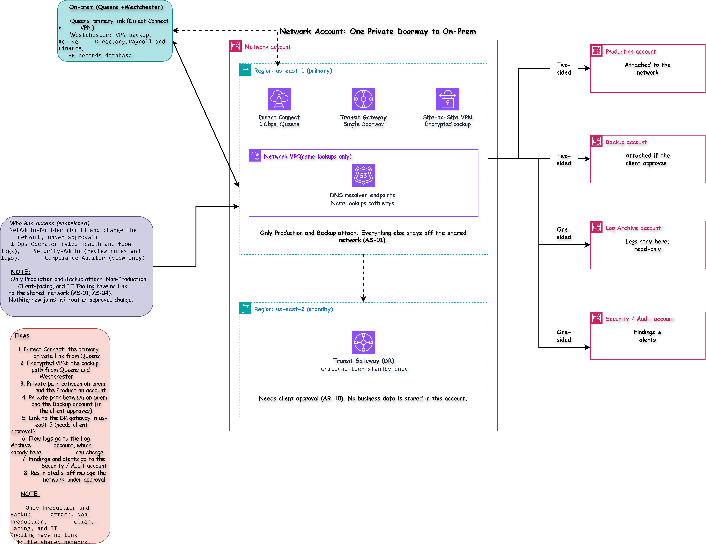

# Network Account: One Private Doorway to On-Prem

[Open the sharp SVG version](../architecture-blueprints/svg/networkaccount.svg)
| | |
|---|---|
| **Project** | NY staffing company, multi-account AWS architecture |
| **Account** | Network (account 4 of 9) |
| **OU** | Infrastructure |
| **Region** | us-east-1 (primary), us-east-2 (DR gateway, needs approval) |
| **Document status** | Draft for client review |

> [!NOTE]
> **Status labels used in this document**
> - **Confirmed**: stated by the client in the brief or in discussion with the client
> - **Proposed**: my design choice, to be validated with the client
> - **Needs approval**: a figure or choice the client must sign off

## Contents

1. [Purpose](#1-purpose)
2. [What runs here and what must never run here](#2-what-runs-here-and-what-must-never-run-here)
3. [Architecture](#3-architecture)
4. [The two links](#4-the-two-links)
5. [When a link fails](#5-when-a-link-fails)
6. [Who may attach](#6-who-may-attach)
7. [Name lookups](#7-name-lookups)
8. [Inspection and logging](#8-inspection-and-logging)
9. [The DR gateway](#9-the-dr-gateway)
10. [Cost](#10-cost)
11. [Guardrails](#11-guardrails)
12. [Access](#12-access)
13. [Connections](#13-connections)
14. [What the network layer inherits](#14-what-the-network-layer-inherits)
15. [Requirements covered](#15-requirements-covered)
16. [Decision records](#16-decision-records)
17. [Risks](#17-risks)
18. [Open questions](#18-open-questions)
19. [Review checklist](#19-review-checklist)

---

## 1. Purpose

The Network account is **the single private doorway between the company's own sites and AWS**. It exists so that:

- the data centers in Queens and Westchester have one reliable, private way into AWS (CR-01),
- clock in/out keeps working if the main link fails (CR-03),
- payroll and HR traffic never travels over the public internet alone (CR-02),
- only the accounts that need a link get one, so mistakes in dev, test, or the owner portal can never reach the company's systems (AS-01, AS-04),
- connectivity is built, watched, and changed in one place by a small team (CT-04).

> [!IMPORTANT]
> The Network account **connects and routes. It stores no business data and runs no workloads.** Only Production and Backup attach to it. Every other account stays off the shared network.

## 2. What runs here and what must never run here

| Runs here | Purpose | Requirement | Status |
|---|---|---|---|
| Direct Connect (1 Gbps, Queens) | The primary private link to AWS | CR-01, CR-04 | Needs approval |
| Site-to-Site VPN (Queens and Westchester) | Encrypted backup path | CR-03, CR-05 | Proposed |
| Transit Gateway (us-east-1) | The hub that Production and Backup attach to | CR-01 | Proposed |
| Name-lookup endpoints | Let AWS and on-prem find each other by name | IR-01 | Proposed |
| Transit Gateway in us-east-2 | A gateway for the critical-tier standby | AR-10 | Needs approval |

| Must never run here | Where it lives instead | Reason |
|---|---|---|
| Servers, databases, or any workload | Production, Non-Production, Client-facing | This account connects only |
| Business data | On-prem, Production, Client-facing | SC-01 |
| Internet front doors for field employees | Production | Staff reach the app through Production's own front door (ADR-C4) |
| Internet front door for building owners | Client-facing | AS-04 |
| Backups | Backup account | AS-03 |
| Logs | Log Archive account | AS-02 |
| A traffic-inspection firewall | Not in phase 1 | See ADR-NW4 |

## 3. Architecture

[Open the sharp SVG version](../architecture-blueprints/04-network-account.svg)

**Flows**

| # | Flow | Purpose | Requirement |
|---|---|---|---|
| 1 | Direct Connect: the primary private link from Queens | Main path to AWS | CR-01 |
| 2 | Encrypted VPN: the backup path from Queens and Westchester | Keep working if the main link fails | CR-03 |
| 3 | Private path between on-prem and the Production account | AD login, payroll, and HR | CR-02 |
| 4 | Private path between on-prem and the Backup account (if the client approves) | Off-site copies of payroll and HR data | ADR-B4 |
| 5 | Link to the DR gateway in us-east-2 (needs client approval) | Reach on-prem during a regional failure | AR-10 |
| 6 | Flow logs go to the Log Archive account | Evidence of what crossed the network | AS-02 |
| 7 | Findings and alerts go to the Security / Audit account | Central security review | SC-09 |
| 8 | Restricted staff manage the network, under approval | Controlled changes | CT-04 |

**Components**

| Component | What it does | Status |
|---|---|---|
| Direct Connect | A private cable between Queens and AWS | Needs approval |
| Site-to-Site VPN | An encrypted tunnel over the internet, from both sites | Proposed |
| Transit Gateway | The hub where accounts attach and where routes are controlled | Proposed |
| Name-lookup endpoints | Pass name questions between AWS and on-prem | Proposed |
| DR gateway (us-east-2) | The same hub in the second region | Needs approval |

## 4. The two links

| | Direct Connect | Site-to-Site VPN |
|---|---|---|
| Role | The **main** path | The **backup** path |
| What it is | A private cable from Queens to AWS | An encrypted tunnel over the ordinary internet |
| Starts at | Queens | Queens and Westchester |
| Speed | Steady, about 1 Gbps to start (CR-04) | Slower and less predictable |
| Cost | Higher: a monthly port charge, a setup lead time | Low |
| Requirement | CR-01, CR-05 | CR-03, CR-05 |
| Status | Needs approval | Proposed |

**What travels over them**

| Traffic | Why it crosses |
|---|---|
| Active Directory logins and name lookups | Staff sign in with AD, which lives on-prem (IR-01) |
| Approved weekly hours going to payroll | Production sends them to the payroll system (WP-08) |
| The employee roster coming from HR | Dispatch and clock-in need it (WP-09) |
| Off-site backups of payroll and HR | Only if the client approves (ADR-B4) |

**What does not travel over them**

| Not carried | Why |
|---|---|
| Field employees clocking in | They reach the app through Production's own front door on the internet (ADR-C4) |
| Building owners | They use the Client-facing portal over the internet |
| The sensitive document shares | No reason to reach them from AWS (SC-02) |

**Encryption.** Direct Connect is private but not encrypted by default. Applications use encrypted connections over it (SC-07). Whether to add encryption to the link itself is a Needs approval item.

**Lead time.** A new Direct Connect link can take weeks to order and install, because the client has no experience with it (CR-06). The order must start early, so it does not hold up wave 1.

## 5. When a link fails

| Situation | What happens | What the client notices | Status |
|---|---|---|---|
| Direct Connect fails | Traffic moves to the VPN automatically | A slowdown, not an outage | Proposed |
| Queens site is unavailable | The Westchester VPN becomes the path | Slower, and Queens-hosted systems are down | Proposed |
| Both links fail | AWS cannot reach on-prem. AD logins, the payroll feed, and the HR roster stop | Staff cannot sign in to apps that need AD. The owner portal keeps working, because it does not use AD | Needs approval |

> [!WARNING]
> Clock in/out checks logins against Active Directory (IR-02), and AD is on-prem. If both links fail, clock in/out cannot check new sign-ins. Two mitigations are open for the client to decide: run a copy of AD in AWS (IR-07, OQ-NW3), and let Production hold approved hours until the link returns (Proposed).

## 6. Who may attach

| Account | Attached? | Why |
|---|---|---|
| Production | Yes | AD login, payroll, and HR (CR-02) |
| Backup | Yes, if the client approves | Off-site copies of payroll and HR data (ADR-B4) |
| Non-Production | **No** | No path from test to live systems (AS-01) |
| Client-facing | **No** | One-way only (AS-04) |
| IT Tooling | **No** | Roles only, no network link |
| Log Archive, Security / Audit, Management | **No** | They talk account to account |

| Rule | Why | Requirement | Status |
|---|---|---|---|
| Only Production and Backup attach, and nothing new joins without an approved change request | Keeps the separation built into the other accounts | AS-01 | Proposed |
| Production and Backup each reach on-prem only, never each other through this hub | A problem in one cannot spread to the other | AS-01 | Proposed |
| A new attachment needs two approvers | No quiet growth of the shared network | AS-06 | Proposed |

## 7. Name lookups

AWS and on-prem need to find each other by name. Active Directory, payroll, and HR are reached by name, not by number.

| Direction | What it does | Requirement | Status |
|---|---|---|---|
| From AWS to on-prem | AWS asks on-prem names such as the domain controllers | IR-01 | Proposed |
| From on-prem to AWS | On-prem asks for the names of AWS services it must reach | IR-01 | Proposed |
| Shared by Production and Backup | One set of endpoints, kept in this account | CT-04 | Proposed |

The detailed rules (which names, which servers) belong to the network layer.

## 8. Inspection and logging

| Item | Decision | Requirement | Status |
|---|---|---|---|
| Flow logs | Record what crosses the hub and send it to the Log Archive account | AS-02, SC-04 | Proposed |
| Traffic-inspection firewall | Not in phase 1, because it adds cost and work for a small team. Separation comes from route tables, and nothing is attached beyond Production and Backup | CT-04 | Needs approval |
| Alerts on changes to links or attachments | Immediate notice to the Security / Audit account | SC-09 | Proposed |
| Review after wave 1 | Decide whether inspection is needed once real traffic is known | CT-04 | Proposed |

## 9. The DR gateway

| Item | Detail | Requirement | Status |
|---|---|---|---|
| A smaller gateway in us-east-2 | Lets the critical-tier standby reach on-prem during a regional failure | AR-10 | Needs approval |
| Linked to the main gateway | Same rules and same list of who may attach | AS-01 | Proposed |
| Not used day to day | A standby only | CT-01 | Proposed |
| No business data stored | Connectivity only | SC-01 | Proposed |

If the client decides the critical tier needs no connection to on-prem during a regional failure, this component is dropped and the diagram loses one box.

## 10. Cost

| Cost item | What drives it | Control | Requirement |
|---|---|---|---|
| Direct Connect port and data | The size of the link and the amount of data | Start at 1 Gbps; check what the waves really use | CT-01 |
| Transit Gateway | Each attachment and the data passing through | Keep attachments to two; schedule off-site backups outside working hours | CT-01 |
| VPN | Per tunnel | Two sites, kept small | CT-01 |
| The DR gateway | A second gateway | Only if approved | CT-01 |

A budget alert applies to this account like the others (CT-01).

## 11. Guardrails

Rules attached to this account, in addition to the ones inherited from the Root and the Infrastructure OU. They apply whatever permissions a person holds in this account.

| # | Guardrail | Attached to | Purpose | Requirement | Status |
|---|---|---|---|---|---|
| 1 | Deny attaching any account to the shared network except Production and Backup | Root | Non-Production, Client-facing, and IT Tooling stay off | AS-01 | Proposed |
| 2 | Deny changes to the links and the gateway, except by two approved administrators | This account | The hub cannot be changed quietly | AS-06 | Proposed |
| 3 | Deny creating servers and databases | This account | Keeps it connectivity-only | SC-01 | Proposed |
| 4 | Deny creating public front doors | This account | Staff and owners enter elsewhere | AS-04 | Proposed |
| 5 | Deny turning off flow logs | This account | The record stays complete | AS-02 | Proposed |
| 6 | Deny stopping or deleting CloudTrail, Config, and GuardDuty | Root (inherited) | Detection stays on | SC-08 | Proposed |
| 7 | Deny any region except us-east-1 and us-east-2 | Root (inherited) | Keeps the network in approved US regions | SC-01 | Proposed |

## 12. Access

Few people sign in here, and none of them can reach business data through it.

| Permission set | Who | Purpose | Access in Network | Key control | Status |
|---|---|---|---|---|---|
| `NetAdmin-Builder` | Network administrators | Build and change the network | Change links, gateways, and attachments under an approved change request | Two-person approval for link and attachment changes; no changes at payroll quarter-end or tax periods (CT-03) | Proposed |
| `ITOps-Operator` | IT operations staff | Watch the network | View link health and flow logs; no changes | MFA, actions logged | Proposed |
| `Security-Admin` | Security team | Review rules and logs | Read access to configuration and logs | Reads, never writes | Proposed |
| `Compliance-Auditor` | Internal and external auditors | Gather SOC 2 style evidence | View-only | Time-boxed for audits (SC-04) | Confirmed |
| `Org-Admin` | Two or three named senior IT staff | Change account-level settings | Account-level settings only | Two-person approval; alert on use | Proposed |

**Who has no access:** workload teams, database administrators, backup staff, field employees, supervisors, building owners, and all external parties (IR-02, IR-06). The carrier that installs the Direct Connect link works on its own equipment and has no access to this account.

| Control | Purpose | Requirement |
|---|---|---|
| Sign in through IAM Identity Center, with Active Directory as the source | One set of accounts | IR-01 |
| MFA on every sign-in | Protect against stolen passwords | IR-02 |
| No long-lived IAM users and no standing admin rights | Remove permanent keys that can leak | IR-04 |
| Root user held under dual control, used only in emergencies | Protect the most powerful identity | IR-05 |
| Alerts on changes to links, gateways, and attachments | Early warning of misuse | SC-09 |
| Access reviewed every quarter | Catch roles that are no longer needed | SC-04 |

## 13. Connections

| # | Connects to | Direction | Purpose | Path | Requirement |
|---|---|---|---|---|---|
| 1 | On-prem (Queens, Westchester) | Both ways | Reach AD, payroll, and HR | Direct Connect (main), VPN (backup) | CR-01, CR-03 |
| 2 | Production account | Both ways | Private path to on-prem | Attached to the Transit Gateway | CR-02 |
| 3 | Backup account | Both ways | Off-site copies, if approved | Attached to the Transit Gateway | ADR-B4 |
| 4 | DR gateway (us-east-2) | One way | Reach on-prem during a regional failure | Gateway to gateway, if approved | AR-10 |
| 5 | Log Archive account | Logs out | Evidence | Account to account | AS-02 |
| 6 | Security / Audit account | Findings out | Central security review | Account to account | SC-09 |
| 7 | Restricted staff | Access in | Manage the network | Through IAM Identity Center | IR-01 |

The Network account has **no internet front door and no link to Non-Production, Client-facing, or IT Tooling.**

## 14. What the network layer inherits

This document fixes the shape of the connectivity. The next phase fills in the detail.

| To be designed in the network layer | Depends on |
|---|---|
| The address plan for each account and for on-prem | The attachments in section 6 |
| Route tables on the hub | The rule that Production and Backup never reach each other |
| Security rules between on-prem and each account | The traffic list in section 4 |
| Name-lookup rules | Section 7 |
| VPN settings and failover behavior | Section 5 |
| Flow log settings | Section 8 |
| Production's own internet front door | ADR-C4 |

## 15. Requirements covered

AS-01, AS-04, AS-06, AR-10, CR-01 to CR-07, CT-01, CT-03, CT-04, IR-01, IR-02, IR-04 to IR-07, SC-01, SC-04, SC-07 to SC-09, WP-07 to WP-09.

## 16. Decision records

| ID | Decision | Options considered | Decision | Status |
|---|---|---|---|---|
| ADR-NW1 | The hub | Direct links from each account, or one Transit Gateway | One Transit Gateway. Only two accounts attach today, but a hub keeps one doorway, controls routing in one place, and leaves room to grow | Proposed |
| ADR-NW2 | The links | VPN only, Direct Connect only, or Direct Connect with a VPN backup | Direct Connect with a VPN backup, which meets CR-03 and the budget in CR-05 | Needs approval |
| ADR-NW3 | Who may attach | Any account, or an approved list | Production and Backup only, with a guardrail and a two-approver rule (AS-01) | Proposed |
| ADR-NW4 | Traffic inspection | A firewall in phase 1, or route separation and flow logs | Route separation and flow logs, reviewed after wave 1 | Needs approval |
| ADR-NW5 | The DR region | A gateway in us-east-2, or no connection there | A smaller gateway, only if the client approves the critical-tier standby (AR-10) | Needs approval |
| ADR-NW6 | How field employees reach clock in/out | Through this network, or Production's own front door | Production's own front door. This network carries company systems only (ADR-C4) | Proposed |

## 17. Risks

| Risk | Impact | Mitigation |
|---|---|---|
| Both links fail | AD logins, the payroll feed, and the HR roster stop | Run a copy of AD in AWS (IR-07), hold approved hours until the link returns, and test the failover |
| One Direct Connect cable at one location is a single point of failure | The VPN carries everything until it is repaired | Keep the VPN tested and sized for the critical flows; consider a second link later if the client wants it |
| The Direct Connect order takes longer than expected | Wave 1 is delayed | Start the order first, and plan wave 1 so it can run on the VPN |
| Bandwidth is underestimated, especially with off-site backups (CR-04) | A slowdown that affects clock in/out | Check the real use in wave 1, and run backups outside working hours |
| A route mistake lets two accounts reach each other | The separation fails | Separate route tables, two-person approval, and a quarterly route review |
| Cost grows beyond the budget | A surprise on the bill | Keep attachments to two, review the data charges monthly, and set a budget alert |

## 18. Open questions

| ID | Question | Why it matters |
|---|---|---|
| OQ-NW1 | Which Direct Connect location and carrier will Queens use? | The order and the lead time depend on it (AX-01) |
| OQ-NW2 | How much bandwidth do the migration waves need beyond steady state? | One link may not be enough during a wave |
| OQ-NW3 | Will the client run a copy of Active Directory in AWS? (same as IR-07 and OQ-02) | Decides what still works if both links fail |
| OQ-NW4 | Who approves Direct Connect spending? (same as OQ-04 and CT-05) | Blocks the order |
| OQ-NW5 | What on-prem equipment will end the VPN tunnels, and can it do so? | Decides the VPN design |
| OQ-NW6 | Does the client accept no inspection firewall in phase 1? | Decides cost and the review after wave 1 |
| OQ-NW7 | Does the critical-tier standby need to reach on-prem during a regional failure? | Decides whether the DR gateway is built |

## 19. Review checklist

- [ ] The diagram and this document show the same components and arrows
- [ ] Only Production and Backup have an arrow to the network, and no arrow runs to Non-Production, Client-facing, or IT Tooling
- [ ] Every row traces to at least one requirement ID
- [ ] The permission sets match the access profiles in the access control requirements
- [ ] The failure table in section 5 agrees with the Production and Backup files
- [ ] The guardrails here are added to the Management account's guardrail list
- [ ] ADR-NW2, ADR-NW4, and ADR-NW5 are agreed with the client before anything is built
- [ ] Open questions OQ-NW1 to OQ-NW7 are added to the central list in `requirements.md`

## Change log

| Version | Date | Author | Change |
|---|---|---|---|
| 0.1 | 2026-10-24 | | First draft |
