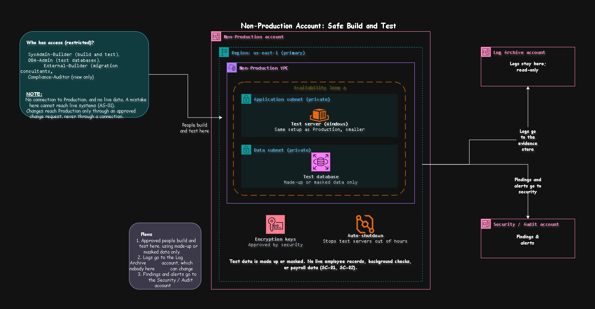

# Non-Production Account: Safe Build and Test

[Open the sharp SVG version](../architecture-blueprints/svg/nonproductionaccount.svg)

| | |
|---|---|
| **Project** | NY staffing company, multi-account AWS architecture |
| **Account** | Non-Production (account 7 of 9) |
| **OU** | Workloads > Non-Production |
| **Region** | us-east-1 only |
| **Document status** | Draft for client review |

> [!NOTE]
> **Status labels used in this document**
> - **Confirmed**: stated by the client in the brief
> - **Proposed**: my design choice, to be validated with the client
> - **Needs approval**: a figure or choice the client must sign off

## Contents

1. [Purpose](#1-purpose)
2. [What runs here and what must never run here](#2-what-runs-here-and-what-must-never-run-here)
3. [Architecture](#3-architecture)
4. [Test data rules](#4-test-data-rules)
5. [How changes reach Production](#5-how-changes-reach-production)
6. [Cost controls](#6-cost-controls)
7. [Guardrails](#7-guardrails)
8. [Access](#8-access)
9. [Connections](#9-connections)
10. [Requirements covered](#10-requirements-covered)
11. [Decision records](#11-decision-records)
12. [Risks](#12-risks)
13. [Open questions](#13-open-questions)
14. [Review checklist](#14-review-checklist)

---

## 1. Purpose

The Non-Production account is **where the client builds, tests, and rehearses without any chance of touching live systems or live data**. It exists so that:

- production is kept apart from dev and test (AS-01),
- each of the three migration waves can be rehearsed before it reaches Production (CT-02),
- the small IT team can learn AWS safely, because mistakes here cost nothing (CT-04),
- a failed experiment can never expose employee records, background check results, or payroll data (SC-01, SC-02).

> [!IMPORTANT]
> This account is deliberately **lighter than Production**: one Availability Zone, no standby database, no load balancer, and no disaster recovery. The brief says dev and test are not critical (AR-08), so spending on resilience here would only add cost.

## 2. What runs here and what must never run here

| Runs here | Purpose | Requirement | Status |
|---|---|---|---|
| Test application servers (Windows) | Build and test clock in/out, dispatch, and reporting changes | WP-03 | Confirmed |
| Test database | Test data changes and migrations | WP-03 | Confirmed |
| Migration rehearsals | Try each wave before it reaches Production | CT-02 | Proposed |
| Vendor software tests for the scheduling application | Check the software runs on AWS before wave 2 | WP-11, AX-03 | Proposed |
| Encryption keys for the test storage | Protect test data, approved by the Security team | SC-07 | Proposed |
| Automatic shutdown of test servers out of hours | Keep the bill low | CT-01 | Proposed |

| Must never run here | Where it lives instead | Reason |
|---|---|---|
| Live employee records, background checks, payroll, or HR data | On-prem, or Production where approved | Test data must be made up or masked (SC-01, SC-02) |
| Live workloads | Production, Client-facing | AS-01 |
| Backups | Backup account | AS-03 |
| Logs | Log Archive account | AS-02 |
| Restore tests of live backups | An isolated restore-test area in Production | A restored live backup contains live data (see ADR-N5) |
| Connections to on-prem | Network account | Not needed here (see OQ-N2) |

## 3. Architecture

[Open the sharp SVG version](../architecture-blueprints/07-non-production-account.svg)

**Flows**

| # | Flow | Purpose | Requirement |
|---|---|---|---|
| 1 | Approved people build and test here, using made-up or masked data only | Safe development | AS-01, SC-01 |
| 2 | Logs go to the Log Archive account, which nobody here can change | Evidence | AS-02 |
| 3 | Findings and alerts go to the Security / Audit account | Central security review | SC-09 |

**Components**

| Component | What it does | Status |
|---|---|---|
| Non-Production VPC | A private network for test workloads, with address ranges defined in the network layer | Proposed |
| One Availability Zone | Keeps cost low, because test work does not need to survive a zone failure | Proposed |
| Application subnet (private) | Holds the test server | Proposed |
| Data subnet (private) | Holds the test database | Proposed |
| Test server (Windows) | Same setup as Production, in a smaller size | Proposed |
| Test database | Made-up or masked data only | Proposed |
| Encryption keys | Protect the test storage, approved by Security | Proposed |
| Auto-shutdown | Stops test servers outside working hours | Proposed |

## 4. Test data rules

| Rule | Purpose | Requirement | Status |
|---|---|---|---|
| Test data is made up, or a masked copy where real names, Social Security numbers, and background check details are replaced | A leak or a mistake exposes nothing real | SC-01, SC-02 | Proposed |
| Raw copies of production databases never enter this account | No live data in a less protected place | AS-01 | Proposed |
| Masking happens before data leaves its source, by an approved process | Real data never travels | SC-01 | Needs approval |
| Test data is deleted at the end of each wave | No old copies build up | SC-01 | Proposed |
| Nobody uses real employee identities for testing | Protect staff privacy | SC-01 | Proposed |

## 5. How changes reach Production

There is **no connection between Non-Production and Production** (AS-01). Changes move by people and process, not by a network path.

| Step | What happens | Who | Requirement |
|---|---|---|---|
| 1 | Build and test the change here | `SysAdmin-Builder`, `DBA-Admin` | WP-03 |
| 2 | Record the test result and raise a change request | `SysAdmin-Builder` | CT-03 |
| 3 | The client approves the change | IT lead | CT-03 |
| 4 | Apply the same change in Production, in an approved window and never at payroll quarter-end or tax periods | `SysAdmin-Builder` (per-change approval) | CT-03 |
| 5 | The change and the approval are logged | Automatic | AS-02 |

Keeping the build instructions as code in the repo means the same instructions can be applied in both accounts, so Production is built from the tested version and not from memory.

## 6. Cost controls

| Control | Detail | Requirement | Status |
|---|---|---|---|
| Auto-shutdown | Test servers stop in the evening and on weekends | CT-01 | Proposed |
| Smaller sizes than Production | Test needs less capacity | CT-01 | Proposed |
| One Availability Zone, no standby | Half the resources of Production | CT-01 | Proposed |
| Cost allocation tags | Every resource carries owner, workload, environment, and wave | CT-02 | Proposed |
| Budget alert for this account | Early warning if test spending drifts | CT-01 | Proposed |
| No backups | Rebuilt from code instead (ADR-B3) | AR-08 | Confirmed |

## 7. Guardrails

Rules attached to the Non-Production OU, in addition to the ones inherited from the Root. They are lighter than the Production OU's rules, so the team can experiment, but a few protect the separation.

| # | Guardrail | Attached to | Purpose | Requirement | Status |
|---|---|---|---|---|---|
| 1 | Deny connecting to the shared network or to any Production account | Non-Production OU | No path from test to live systems | AS-01 | Proposed |
| 2 | Deny receiving shared data, snapshots, or backups from Production accounts | Non-Production OU | Live data cannot be copied in | SC-01, SC-02 | Proposed |
| 3 | Deny public access to storage | Non-Production OU | Test data can't be exposed | SC-01 | Proposed |
| 4 | Deny very large server sizes | Non-Production OU | Protects the budget | CT-01 | Proposed |
| 5 | Deny stopping or deleting CloudTrail, Config, and GuardDuty | Root (inherited) | Detection stays on | SC-08 | Proposed |
| 6 | Deny any region except us-east-1 and us-east-2 | Root (inherited) | Keeps test data in approved US regions | SC-01 | Proposed |

> [!NOTE]
> Guardrails are tested here first, before they are attached to the Production OU. This account is also where the Security team trials new rules.

## 8. Access

Builders get more freedom here than in Production, and the guardrails still apply.

| Permission set | Who | Purpose | Access in Non-Production | Key control | Status |
|---|---|---|---|---|---|
| `SysAdmin-Builder` | Senior system administrators | Build and test changes | Create, change, and delete test resources; no per-change approval needed here | Actions logged | Proposed |
| `DBA-Admin` | Database administrators | Work on test databases | Administer test databases | Actions logged | Proposed |
| `External-Builder` | Migration consultants | Rehearse waves 1 and 2 | Build and migrate during the waves only | Removed after wave 2 (IR-06) | Proposed |
| `Compliance-Auditor` | Internal and external auditors | Gather SOC 2 style evidence | View-only | Time-boxed for audits (SC-04) | Confirmed |
| `Security-KeyApprovers` | Named security staff | Approve use of the test keys | Approve key policy changes; no access to the data | Two approvers for key changes (SC-07) | Proposed |
| `Org-Admin` | Two or three named senior IT staff | Change account-level settings | Account-level settings only | Two-person approval; alert on use | Proposed |

**Who has no access:** field employees, supervisors, back-office staff, IT operations staff, and the after-hours provider (IR-02, IR-06). Whether the scheduling vendor gets time-limited access is an open question (OQ-N3).

| Control | Purpose | Requirement |
|---|---|---|
| Sign in through IAM Identity Center, with Active Directory as the source | One set of accounts | IR-01 |
| MFA on every sign-in | Protect against stolen passwords | IR-02 |
| No long-lived IAM users and no standing admin rights | Remove permanent keys that can leak | IR-04 |
| Root user held under dual control, used only in emergencies | Protect the most powerful identity | IR-05 |
| External access expires automatically | No forgotten consultant access | IR-06 |
| Access reviewed every quarter | Catch roles that are no longer needed | SC-04 |

## 9. Connections

| # | Connects to | Direction | Purpose | Path | Requirement |
|---|---|---|---|---|---|
| 1 | Builders and consultants | Access in | Build and test | Through IAM Identity Center | IR-01 |
| 2 | Log Archive account | Logs out | Evidence | Account to account | AS-02 |
| 3 | Security / Audit account | Findings out | Central security review | Account to account | SC-09 |

Non-Production has **no connection to Production, no connection to on-prem, and none to the internet**, apart from what builders need to reach it and what is needed to send logs and findings. Whether testing needs a path to on-prem is an open question (OQ-N2).

## 10. Requirements covered

AS-01, AR-08, CT-01 to CT-04, SC-01, SC-02, SC-04, SC-07 to SC-09, IR-01, IR-02, IR-04 to IR-06, WP-03, WP-11.

## 11. Decision records

| ID | Decision | Options considered | Decision | Status |
|---|---|---|---|---|
| ADR-N1 | How resilient Non-Production is | A copy of Production, or a lighter single-zone design | Single zone, no standby, no disaster recovery, because dev and test are not critical (AR-08) | Confirmed |
| ADR-N2 | How changes reach Production | A shared network path, or people and approved change requests | Approved change requests, with no connection between the accounts (AS-01) | Proposed |
| ADR-N3 | What data tests use | Copies of live data, masked copies, or made-up data | Made-up or masked data only (SC-01, SC-02) | Proposed |
| ADR-N4 | Cost control | Run all day, or stop out of hours | Auto-shutdown out of hours, with a budget alert | Proposed |
| ADR-N5 | Where restore tests of live backups run | Here, or an isolated area in Production | An isolated restore-test area in Production, so live data never enters this account | Proposed |

## 12. Risks

| Risk | Impact | Mitigation |
|---|---|---|
| Live data is copied in to "make testing easier" | A leak from a less protected account | Guardrail on shared snapshots, a masking process, and a review of the account's data every quarter |
| Test servers run all night and at weekends | Unplanned cost | Auto-shutdown and a budget alert |
| Consultant access outlives the migration waves | A forgotten outside user | Access expires automatically after wave 2 (IR-06) |
| Test works but Production differs | A failed change in a live system | Build both from the same code and rehearse each wave first |
| A single zone cannot test failover | Failover problems are found late | Test failover in the isolated restore-test area in Production, with a recorded result |
| Lighter rules become a route to Production | Separation fails | Guardrail 1 and 2, no connection, and changes only through approved requests |

## 13. Open questions

| ID | Question | Why it matters |
|---|---|---|
| OQ-N1 | Who approves the masking process for any test data derived from live data? | Needed before any realistic test data is used |
| OQ-N2 | Does testing need a test directory or a link to on-prem for login and integrations? | Affects the network layer and the isolation |
| OQ-N3 | Does the scheduling vendor get time-limited access to test their software? | Affects the access table and wave 2 |
| OQ-N4 | What working hours should the auto-shutdown follow? | Decides the saving |
| OQ-N5 | Does the client agree that dev and test are rebuilt from code instead of backed up? | Confirms ADR-B3 |

## 14. Review checklist

- [ ] The diagram and this document show the same components and arrows
- [ ] There is no arrow or connection between this account and Production
- [ ] Every row traces to at least one requirement ID
- [ ] The permission sets match the access profiles in the access control requirements
- [ ] The Backup and Production files agree that restore tests of live backups do not run in this account
- [ ] The guardrails here are added to the Management account's guardrail list
- [ ] Open questions OQ-N1 to OQ-N5 are added to the central list in `requirements.md`

## Change log

| Version | Date | Author | Change |
|---|---|---|---|
| 0.1 | 2026-10-23 | | First draft |
