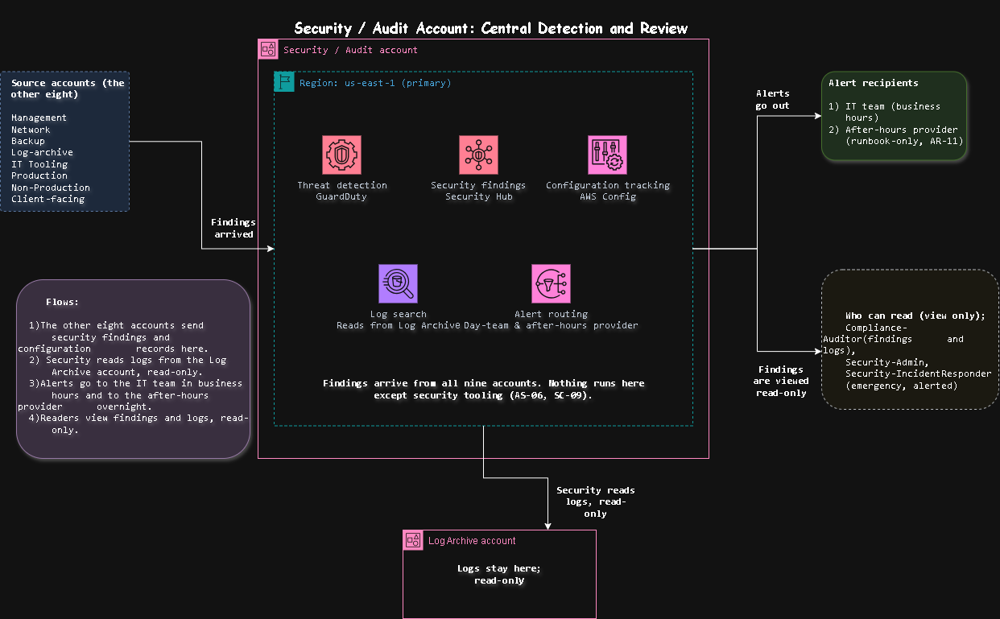

# Security / Audit Account: Central Detection and Review

[Open the sharp SVG version](../architecture-blueprints/securityauditaccount.svg)

| | |
|---|---|
| **Project** | NY staffing company, multi-account AWS architecture |
| **Account** | Security / Audit (account 2 of 9) |
| **OU** | Security |
| **Region** | us-east-1 (primary); detection also switched on in us-east-2 and gathered into us-east-1 |
| **Document status** | Draft for client review |

> [!NOTE]
> **Status labels used in this document**
> - **Confirmed**: stated by the client in the brief
> - **Proposed**: my design choice, to be validated with the client
> - **Needs approval**: a figure or choice the client must sign off

## Contents

1. [Purpose](#1-purpose)
2. [What runs here and what must never run here](#2-what-runs-here-and-what-must-never-run-here)
3. [Architecture](#3-architecture)
4. [Alerting](#4-alerting)
5. [Protection](#5-protection)
6. [Guardrails](#6-guardrails)
7. [Access](#7-access)
8. [Connections](#8-connections)
9. [Requirements covered](#9-requirements-covered)
10. [Decision records](#10-decision-records)
11. [Risks](#11-risks)
12. [Open questions](#12-open-questions)
13. [Review checklist](#13-review-checklist)

---

## 1. Purpose

The Security / Audit account is the **one place where security problems from all nine accounts are detected, collected, and reviewed**. It exists so that:

- the security team sees every issue in one place, instead of signing in to eight accounts (SC-09),
- the people who review security are separate from the people who run the workloads (AS-06),
- auditors can read findings and logs without touching a workload account (SC-04),
- the small IT team is told about what matters, at the right time, including nights and weekends (CT-04, AR-11).

> [!IMPORTANT]
> This account **watches and reports**. It does not run workloads, and it does not store the logs themselves, which stay in the Log Archive account.

## 2. What runs here and what must never run here

| Runs here | Purpose | Requirement | Status |
|---|---|---|---|
| Threat detection (GuardDuty) | Spot unusual or hostile activity in every account | SC-09 | Proposed |
| Security findings (Security Hub) | One list of findings from all accounts | SC-09 | Proposed |
| Configuration tracking (AWS Config) | Show how settings changed and whether they follow the rules | SC-04 | Proposed |
| Log search (Athena) | Search the logs held in Log Archive, read-only | SC-04 | Proposed |
| Alert routing (SNS) | Send alerts to the day team and the after-hours provider | AR-11 | Proposed |

| Must never run here | Where it lives instead | Reason |
|---|---|---|
| Application servers, databases, load balancers | Production, Non-Production, Client-facing | This account holds security tooling only |
| Log storage | Log Archive account | Evidence must be out of reach of the people who read it (AS-02) |
| Backups | Backup account | AS-03 |
| Admin and monitoring tools for daily IT work | IT Tooling account | Keeps daily work away from security records |
| Network connections to on-prem | Network account | Shared connectivity is managed in one place |

## 3. Architecture

[Open the sharp SVG version](../architecture-blueprints/02-security-audit-account.svg)

**Flows**

| # | Flow | Purpose | Requirement |
|---|---|---|---|
| 1 | The other eight accounts send security findings and configuration records here | One list of findings across the organization | SC-09 |
| 2 | Security reads logs from the Log Archive account, read-only | Investigate without touching the evidence store | SC-04 |
| 3 | Alerts go to the IT team in business hours and to the after-hours provider overnight | The right person hears about the right problem | AR-11 |
| 4 | Readers view findings and logs, read-only | Review and audit | SC-04 |

**Components**

| Component | What it does | Status |
|---|---|---|
| Threat detection (GuardDuty) | Watches account activity and network behavior for signs of an attack | Proposed |
| Security findings (Security Hub) | Collects findings from every account into one view and checks them against the chosen standards | Proposed |
| Configuration tracking (AWS Config) | Records every configuration change and checks it against the rules | Proposed |
| Log search (Athena) | Lets the security team query logs without signing in to Log Archive | Proposed |
| Alert routing (SNS) | Sends alerts by severity to the right people | Proposed |

## 4. Alerting

A small IT team can't act on hundreds of alerts (CT-04), so the design sends only what matters, and sends it to the right person.

| Severity | Example | Who is told | How fast | Status |
|---|---|---|---|---|
| Critical | Root user sign-in, detection switched off, employee data exposed publicly, unusual access to the payroll or HR path | The on-call security contact and the after-hours provider, day or night | Immediately | Needs approval |
| High | A guardrail change, repeated failed sign-ins, a key policy change | The IT team in business hours, the after-hours provider otherwise | Within one hour | Needs approval |
| Medium and low | Configuration drift, routine findings | A weekly review by the Security team | Weekly | Proposed |

The after-hours provider has **runbook-only access** (AR-11). Their job is to follow the written steps to contain the problem and then reach the named on-call security contact. They never need open access to this account.

## 5. Protection

| Protection | How it helps | Requirement | Status |
|---|---|---|---|
| Detection switched on in both approved regions (us-east-1 and us-east-2) | A region cannot become a blind spot, because the region guardrail allows both | SC-08, SC-09 | Proposed |
| Findings from both regions gathered into us-east-1 | One view for the security team | SC-09 | Proposed |
| Findings exported to the Log Archive account | The tools keep findings for a limited period, so long-term copies go to the evidence store for the 7-year period | SC-06 | Proposed |
| Read-only access to Log Archive | Security can search logs but never change or delete them | AS-02 | Proposed |
| Alerts on any change to detection settings | Immediate notice of anyone trying to switch it off | SC-09 | Proposed |
| Encryption with keys approved by the Security team | Findings and query results are protected | SC-07 | Proposed |
| Public access blocked | No finding or result can be shared outside the organization | SC-01 | Proposed |

## 6. Guardrails

Rules attached to the Security OU, in addition to the ones inherited from the Root. They apply whatever permissions a person holds in this account.

| # | Guardrail | Attached to | Purpose | Requirement | Status |
|---|---|---|---|---|---|
| 1 | Deny switching off or deleting threat detection, Security Hub, and Config in any account | Root (inherited) | Detection can't be disabled by the people it watches | SC-08 | Proposed |
| 2 | Deny changing who runs security tooling, except by two approved administrators | Security OU | Control stays with the Security team | AS-06 | Proposed |
| 3 | Deny deleting findings and configuration history | Security OU | Evidence can't be removed | AS-02 | Proposed |
| 4 | Deny any region except us-east-1 and us-east-2 | Root (inherited) | Keeps findings in approved US regions | SC-01 | Proposed |
| 5 | Deny writing to the Log Archive buckets from this account, apart from exports | Security OU | Security reads logs and cannot alter them | AS-02 | Proposed |

## 7. Access

Few people sign in here, and none of them run workloads.

| Permission set | Who | Purpose | Access in Security / Audit | Key control | Status |
|---|---|---|---|---|---|
| `Security-Admin` | Security team (inside IT) | Review findings, tune alerts, search logs | Read findings and logs; change security settings; cannot change workloads | Separate from the people who run systems (AS-06) | Proposed |
| `Security-IncidentResponder` | Security responders | Contain and investigate an incident | Emergency elevated access | Limited to hours, reason recorded, alert on every use | Proposed |
| `Compliance-Auditor` | Internal and external auditors | Gather SOC 2 style evidence | Read-only findings and logs | Time-boxed for audits (SC-04) | Confirmed |
| `Security-KeyApprovers` | Named security staff | Approve use of the encryption keys here | Approve key policy changes; no access to findings | Two approvers for key changes (SC-07) | Proposed |
| `Org-Admin` | Two or three named senior IT staff | Change who runs security tooling | Account-level settings only | Two-person approval; alert on use | Proposed |

**Who has no access:** workload teams, IT operations staff, database administrators, backup staff, field employees, supervisors, and all external parties (IR-02, IR-06). The after-hours provider gets alerts and runbooks, not sign-in access.

| Control | Purpose | Requirement |
|---|---|---|
| Sign in through IAM Identity Center, with Active Directory as the source | One set of accounts | IR-01 |
| MFA on every sign-in | Protect against stolen passwords | IR-02 |
| No long-lived IAM users and no standing admin rights | Remove permanent keys that can leak | IR-04 |
| Root user held under dual control, used only in emergencies | Protect the most powerful identity | IR-05 |
| Access reviewed every quarter | Catch roles that are no longer needed | SC-04 |

## 8. Connections

| # | Connects to | Direction | Purpose | Path | Requirement |
|---|---|---|---|---|---|
| 1 | The other eight accounts | They send findings in | One list of findings | Account to account, never over the internet | SC-09 |
| 2 | Log Archive account | Read access out | Search and investigate | Account to account, read-only | SC-04 |
| 3 | Alert recipients (IT team and after-hours provider) | Alerts out | Timely response | Email, text message, or on-call tool | AR-11 |
| 4 | Readers (auditors and security staff) | Read access in | Review and audit | Through IAM Identity Center | SC-04 |

Findings exports to Log Archive are covered by flow 1 in the [Log Archive document](./03-log-archive-account.md), where this account is one of the sources.

Security / Audit has **no connection to on-prem and none to the internet**, apart from sending alerts.

## 9. Requirements covered

AS-02, AS-06, AR-11, CT-04, IR-01, IR-02, IR-04 to IR-06, SC-01, SC-04, SC-06 to SC-09.

## 10. Decision records

| ID | Decision | Options considered | Decision | Status |
|---|---|---|---|---|
| ADR-S1 | Separate account for security tooling | Run it in the Management account, or in a workload account, or in a dedicated account | A dedicated account, so the reviewers are separate from the people they watch | Proposed |
| ADR-S2 | How many security checks to switch on | Every available standard, or a small core set | A small core set first, tuned after wave 1, so a 14-person team isn't buried in alerts | Proposed |
| ADR-S3 | Where people search logs | Inside Log Archive, or from this account | From this account with read-only access, matching ADR-L3 | Proposed |
| ADR-S4 | Overnight alerting | Wake the IT team, use the after-hours provider only, or both by severity | Both by severity, with runbooks for the provider | Needs approval |

## 11. Risks

| Risk | Impact | Mitigation |
|---|---|---|
| Too many alerts | The small team ignores them | Start with a small core set, define severities, and review after wave 1 |
| An alert goes to nobody overnight | A serious problem goes unnoticed | A named on-call contact, tested monthly, and a runbook for the after-hours provider |
| Detection is switched off in a region or account | A blind spot | Switch it on in both regions, and alert on any change to detection settings |
| Findings are lost after the tool's retention period ends | Missing evidence for auditors | Export findings to the Log Archive account for the 7-year period |
| One person holds both security review and workload access | A weak separation of duties | Keep the roles separate, and review the permission sets every quarter |

## 12. Open questions

| ID | Question | Why it matters |
|---|---|---|
| OQ-S1 | Who is the named on-call security contact overnight? | Critical alerts need a person at the end of the line |
| OQ-S2 | How should alerts reach people: email, text message, or an on-call tool? | Affects the alert routing design and cost |
| OQ-S3 | Which security standards does the client want switched on first? | Decides how much noise the team receives |
| OQ-S4 | Does the after-hours provider have a runbook for security incidents? | Needed before they can be an alert recipient |

## 13. Review checklist

- [ ] The diagram and this document show the same components and arrows
- [ ] The diagram note and section 5 agree on which regions have detection switched on
- [ ] Every row traces to at least one requirement ID
- [ ] The permission sets match the access profiles in the access control requirements
- [ ] The alerting table is agreed with the client before anything is built
- [ ] Open questions OQ-S1 to OQ-S4 are added to the central list in `requirements.md`

## Change log

| Version | Date | Author | Change |
|---|---|---|---|
| 0.1 | 2026-10-23 | | First draft |
