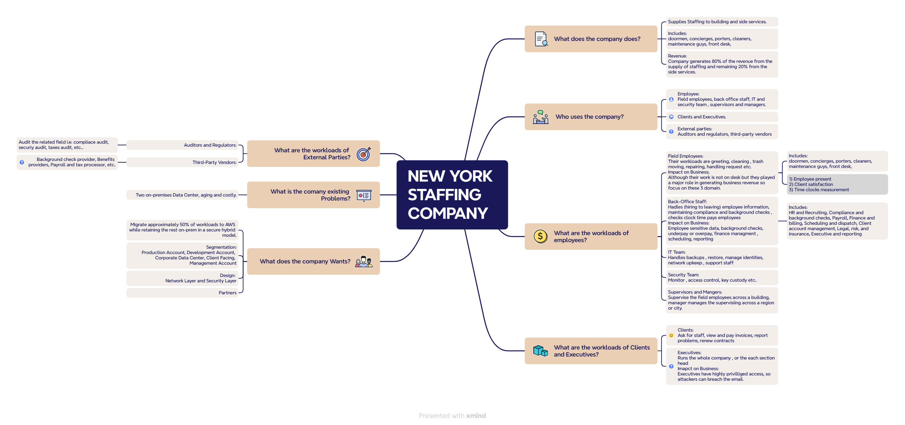

## Business understanding

Before designing anything, I mapped how the business works: who uses its
systems, what they need, which data is sensitive, and what could go wrong.
The map below shows the path from the client's situation to its requirements,
problems, and possible solutions. Every design decision later in this project
traces back to it.

  

*Figure 1: Business understanding map. Scenario details are assumptions for portfolio purposes.*

Now after analyzing the map, there are different group of people who needs to access differently according
to their needs and the company want structured and control access of these groups whether to their business application or 
their AWS application.
The groups are: 
| Groups | Sub-Groups |
| --- | --- |
| Employees | Field Employees |
| Employees | IT Team |
| Employees | Security Team |
| Employees | Back-Office Staff |
| Employees | Supervisors |
| Employees | Managers |
| Clients | Buildings Owner |
| External parties | Vendors and software providers | 
| External parties | Auditors and compliance reviewers | 
| External parties | Contractors and consultants |
| Executives | C-suite (CEO, COO, CFO) |
| Executives | Department heads and directors |
| Executives | Board members and owners |

Their access-control detail and connectively detail is discussed broadly in : 
[Access Control](employees/access-control/)  

