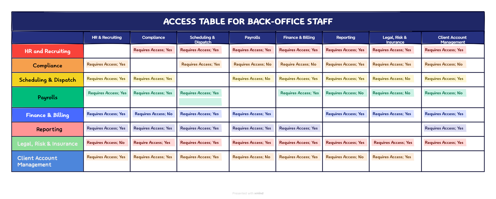

# Employee Access Control: Overview

Before going deep into the Access control Management you will be first able to understand these access related question 
as these are extremely helpful in designing and configuring the access control list :

Questions:
1) What this system needs to access with to perform its workload?
2) Does any other system needs to connect to this system to perform its workload?
3) How the access should be controlled?
4) Does the system(workload and data) lives on AWS or on-premises?
5) Should the access be Business level Access or AWS Level Access?
6) What is the least privilliged access for this system?
7) How the authorization and authentication will happen?
8) What kind of data does the system needs from other system to perform its workload?
   
| Employee Category | System | Transfer Data | Fetching Data | Scope of System | Access Scope | 
| --- | --- | --- | --- | --- | --- | 
| Back-Office Staff | Hiring System, Scheduling System, Reporting System,  Compliance System, Paying System, Financing, Client Account Management System, Legal Risk and Insurance System, Background Check System | External Payment processor, Banks, legal counsel, field employee app(Internal), Within the system inside Back-Office Staff | Background Checks vendor(External Parties) , field employee app(Internal), within the system inside Back-Office Staff | Currently: On-Premise, Future: Some System AWS | Business level Access |

How the access should be controlled? \
This will clearly explain in the employees own section. \
[Back-Office Staff Access Control](back-office-staff.md)

*ACCESS TABLE*

  

