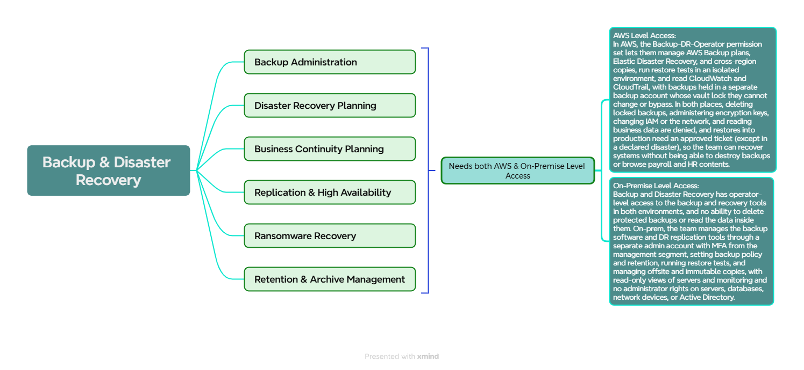

##  *Here is the workloads associated with the IT-Backup & Disaster Recovery Field!*


<p align="center">
  
</p>

### *ACCESS PROFILES / PERMISSION SETS:*

| Field | Details | 
| --- | --- | 
| Team | 	Backup and Disaster Recovery (IT Administration) | 
| Purpose |	Protect and recover systems and data after failures, deletions, ransomware, or site loss, without being able to destroy backups or read their contents |
| Applications and level |	Backup software (administrator), DR replication tools (administrator), monitoring platform (read-only), network monitoring (read-only), SIEM (read-only), ticketing and change calendar (full) |
| Backup and recovery (on-prem)	| Set backup policy and retention, run restore tests, manage offsite and immutable copies, and run DR replication. Restores into production need an approved ticket, except in a declared disaster. |
| Servers, databases, and network devices (on-prem) |	No administrator rights. Read-only status views only. |
| Active Directory | Delegated tasks only: membership of their own backup groups. No Domain Admin. | 
| File shares |	IT and recovery folders only (DR plans, runbooks, test results, backup logs). No business file shares. |
| Business data	| Never read. They restore whole systems, not browse contents. | 
| AWS Permission Set | Backup-DR-Operator: AWS Backup (plans, jobs, restore), Elastic Disaster Recovery, cross-region copy, restore testing in an isolated environment, CloudWatch, read-only CloudTrail | 
| AWS account scope |	Backup account: manage backup plans and restores, but no change to vault lock. DR account or region: build and test the recovery environment. Workload accounts: restore through the change process only. No access to network, security/log archive, management, or billing accounts. | 
| Backup protection | Backups are held in a separate backup account with vault lock and retention rules. This team cannot delete locked backups, shorten retention, or change vault lock settings. | 
| Explicitly denied	| Deleting or shortening protected backups, changing vault lock, reading backup contents, KMS key administration, IAM changes, network and firewall changes, server and database administration, billing, Domain Admin | 
| Network path | Management segment through the jump host (on-prem) and IAM Identity Center sign-in to the AWS console (AWS) | 
| Authentication | Separate admin account with MFA. AWS sign-in through IAM Identity Center with AD credentials. | 
| Privileged access |	Break-glass account for declared disasters: time-limited, logged, and alerted when used | 
| Change control | Production restores need an approved ticket. Emergency restores in a declared disaster are reviewed afterward. |
| Testing and review | Scheduled restore tests and DR drills, with results reviewed by Security and Compliance |
| Logging and audit |	Backup job logs, restore records, and CloudTrail. Every restore is recorded with requester, approver, time, and target system. | 
| Status | Draft, pending client confirmation of RPO and RTO targets, the DR site (AWS or second site), and the workload list |


## Identity and Access Design: Backup and Disaster Recovery

### 1. Purpose
Define how the Backup and Disaster Recovery team signs in and what it can do on-premises and in AWS, so the team can protect and recover systems and data without being able to destroy protected backups, read their contents, or manage encryption keys.

### 2. Client Requirements
| # | Requirement |
|---|---|
| R1 | Staff use their existing login. No separate AWS passwords. |
| R2 | The backup team restores whole systems but does not read payroll, HR, or background check data inside backups. |
| R3 | Each person gets only what their job needs (least privilege). |
| R4 | Administrative access requires a second verification step (MFA). |
| R5 | Every backup, restore, and recovery action is recorded and traceable to a person. |
| R6 | Disabling one account removes access everywhere. |
| R7 | Protected backups cannot be deleted, shortened, or unlocked by anyone on this team. |
| R8 | Backups are stored in a separate AWS account from the workloads they protect. |
| R9 | Restores into production need an approved ticket, except in a declared disaster. |
| R10 | Restore tests and DR drills run on a schedule, and the results are reviewed by Security and Compliance. |
| R11 | Emergency access during a declared disaster is time-limited, logged, and reviewed afterward. |

### 3. Design Decisions
| Layer | Component | Role |
|---|---|---|
| Identity source | **Active Directory** | Holds user accounts and groups |
| AWS sign-in | **IAM Identity Center** | Syncs from AD and assigns access to AWS accounts |
| AWS permissions | **Permission set `Backup-DR-Operator`** | Defines what the team can manage in AWS backup and recovery services |
| Disaster access | **AD group `BackupDR-DisasterResponders`** | Temporary membership during a declared disaster, extending restore rights into production |
| Backup protection | **Separate backup account with vault lock** | Keeps backups out of reach of workload account compromise and of this team's own permissions |

### 4. Access Flow
```
Backup administrator (separate admin account + MFA)
        |
AD group: BackupDR-Operators
        |
IAM Identity Center (assignment)
        |
Permission set: Backup-DR-Operator
        |
AWS accounts: Backup account (manage plans and restores, no vault lock changes) | DR account or region (build and test) | Workload accounts (restore through the change process)
```

**Production restore (normal):**
```
Restore request ticket → approval by the system owner → restore performed by BackupDR-Operators → recorded in the ticket, AWS Backup, and CloudTrail
```

**Declared disaster (time-limited):**
```
Disaster declared by management → temporary membership in BackupDR-DisasterResponders → restore into production without per-system tickets → automatic removal → alert and post-disaster review
```

### 5. Group-to-Access Mapping
| AD Group | Permission Set / Rights | Scope |
|---|---|---|
| BackupDR-Operators | `Backup-DR-Operator` | AWS: backup account, DR account or region, workload accounts (restore through change process) |
| BackupDR-Operators | Administrator on backup software and DR replication tools | On-prem backup and replication systems, through the jump host |
| BackupDR-DisasterResponders (temporary members) | Production restore without per-system tickets | On-prem and AWS, for the duration of a declared disaster |

### 6. Permission Set: Backup-DR-Operator
**Allowed:** AWS Backup (plans, jobs, restore), Elastic Disaster Recovery, cross-region backup copy, restore testing in an isolated environment, CloudWatch, read-only CloudTrail.

**Denied:** deleting or shortening protected backups, changing vault lock settings, reading backup contents, KMS key administration, IAM changes, network changes (VPC, routing, security groups, VPN, Direct Connect), EC2 and RDS administration in workload accounts, billing, security/log archive account, management account.

### 7. On-Premises Access
| Area | Access |
|---|---|
| Backup software, DR replication tools | Administrator: set policy and retention, run restore tests, manage offsite and immutable copies |
| Monitoring platform, network monitoring, SIEM | Read-only |
| Ticketing and change calendar | Full |
| Active Directory | Delegated: membership of their own backup groups. No Domain Admin. |
| Servers, databases, network devices | No administrator rights. Read-only status views only. |
| Business file shares and data | Denied. Restores bring back whole systems, not browsable content. |
| Remote access | Jump host on the management segment |

### 8. Security Controls
- Separate admin account for privileged work (for example `adm-username`)
- MFA on admin accounts and on IAM Identity Center
- No direct access to backup tools from regular desktops. Jump host on-prem, IAM Identity Center sign-in in AWS.
- Backups stored in a separate AWS account, with vault lock and retention rules that this team cannot change
- Offsite or immutable copies on-prem, so a compromised backup server cannot erase every copy
- Backups encrypted with keys controlled by security, so the backup team cannot decrypt contents
- Service Control Policies prevent anyone from deleting the backup vault or disabling backup plans in workload accounts
- Production restores only through an approved ticket, tracked in the change calendar
- Disaster access (`BackupDR-DisasterResponders`) granted only on a declared disaster, removed automatically, and reviewed afterward
- Restore tests run in an isolated environment, never against live data
- Break-glass account: time-limited, logged, and alerts when used
- Separation of duties: Backup and Disaster Recovery restores systems, Security Administration owns keys and vault policy, System and Server Administration and Database Administration own their systems, Network Administration owns paths

### 9. Audit and Logging
| Environment | Record |
|---|---|
| AWS | AWS Backup job and restore history, CloudTrail (read-only to this team), vault access logs |
| On-premises | Backup job logs, restore records, privileged session logs, SIEM alerts |
| Production restores | Ticket, requester, approver, time, and target system |
| Testing | Restore test and DR drill results, reviewed by Security and Compliance |

### 10. Requirements Traceability
| Requirement | Met by |
|---|---|
| R1, R6 | AD as identity source, synced to IAM Identity Center |
| R2 | No KMS or data-read permissions in `Backup-DR-Operator`. Keys held by security. |
| R3 | Access assigned by group, scoped per account |
| R4 | MFA plus separate admin accounts |
| R5 | AWS Backup history, CloudTrail, backup logs, restore tickets |
| R7 | Vault lock and retention rules set outside this team's permissions, plus SCPs blocking vault deletion |
| R8 | Dedicated backup account |
| R9 | Approved ticket required for production restores, tracked in the change calendar |
| R10 | Scheduled tests and drills, results reviewed by Compliance-Auditors |
| R11 | `BackupDR-DisasterResponders` tied to a declared disaster, auto-removed, alerted, and reviewed |

### 11. Assumptions and Open Items
- AD group names and account scope to be confirmed with the client
- Final workload list for Backup and Disaster Recovery to be confirmed
- RPO and RTO targets per system to be set by the client
- DR site to be confirmed (AWS region, second data center, or both)
- Backup and replication products in use on-prem to be confirmed with the client
- Who can declare a disaster to be decided by the client (for example the owner or head of IT)
- Retention periods to be set by the client, with compliance reviewing them
- Exact IAM policy actions for `Backup-DR-Operator` to be documented in the build guide
