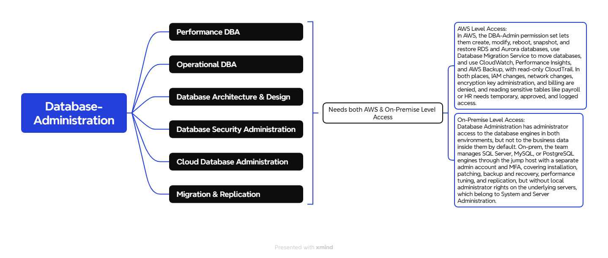

##  *Here is the workloads associated with the IT-Database Administration Field!*


<p align="center">
  
</p>


The current scope of IT-Database Administration Field where mostly its workload and data lives is on On-Premsie \
and the owner wants to migrate it to the AWS now!


### *ACCESS PROFILES / PERMISSION SETS:*

| Field | Details | 
| --- | --- |
| Team | Database Administration (IT Administration) | 
| Purpose	| Install, secure, back up, tune, and migrate databases on-prem and in AWS, without routine access to business data | 
| Applications and level | Database management tools (administrator), database monitoring (full), backup software (administrator for database backups), ticketing and change calendar (full), SIEM (read-only), network monitoring (read-only) | 
| Database engines (on-prem) | Database administrator rights on SQL Server, MySQL, or PostgreSQL: install, configure, patch, back up, restore, tune, and replicate. Sensitive tables (payroll, HR, background checks) are not queried by default. |
| Server access (on-prem)	| No local administrator rights on the underlying servers, which belong to System and Server Administration. Database service accounts only. | 
| Active Directory |	Delegated tasks only: membership of their own database groups. No Domain Admin. | 
| File shares	| IT and database folders only (runbooks, schemas, standards, backup logs). No business file shares. | 
| AWS Permission Set | DBA-Admin: RDS and Aurora (create, modify, reboot, snapshot, restore), Database Migration Service, CloudWatch and Performance Insights, AWS Backup (database plans), read-only CloudTrail | 
| AWS account scope |	Dev: full database rights. Production, client-facing, and corporate: same permission set, with changes only through the change process. Shared services: migration tooling. No access to network, security/log archive, management, or billing accounts. |
| Data access exception |	Reading sensitive tables requires an approved ticket, a time limit, and a logged session, with an alert on every use |
| Explicitly denied |	Routine reads of business data, IAM changes, network and firewall changes, KMS key administration, security log administration, billing, Domain Admin, local administrator on servers |
| Network path | Management segment through the jump host (on-prem) and the approved AWS access path with no public database endpoints (AWS) |
| Authentication |	Separate admin account with MFA. AWS sign-in through IAM Identity Center with AD credentials. Applications use their own service accounts, not DBA accounts. |
| Privileged access |	Break-glass account: time-limited, logged, and alerted when used |
| Logging and audit |	Database activity logging on-prem, CloudTrail and RDS audit logs in AWS, SIEM alerts on sensitive table access |
| Status |	Draft, pending client confirmation of the workload list |


## Identity and Access Design: Database Administration

### 1. Purpose
Define how the Database Administration team signs in and what it can do on-premises and in AWS, so the team can install, secure, back up, tune, and migrate databases without routine access to the business data inside them.

### 2. Client Requirements
| # | Requirement |
|---|---|
| R1 | Staff use their existing login. No separate AWS passwords. |
| R2 | Database administrators manage databases but do not read payroll, HR, or background check data as part of routine work. |
| R3 | Each person gets only what their job needs (least privilege). |
| R4 | Administrative access requires a second verification step (MFA). |
| R5 | Every administrative action and every access to sensitive data is recorded and traceable to a person. |
| R6 | Disabling one account removes access everywhere. |
| R7 | Reading sensitive data requires an approved ticket, a time limit, and an alert on every use. |
| R8 | Applications connect with their own service accounts, never with administrator accounts. |
| R9 | Production changes follow an approved change process. |

### 3. Design Decisions
| Layer | Component | Role |
|---|---|---|
| Identity source | **Active Directory** | Holds user accounts and groups |
| AWS sign-in | **IAM Identity Center** | Syncs from AD and assigns access to AWS accounts |
| AWS permissions | **Permission set `DBA-Admin`** | Defines what the team can manage in AWS database services |
| Sensitive data access | **AD group `DBA-SensitiveData`** | Temporary membership, granted through an approved ticket |

### 4. Access Flow
```
Database administrator (separate admin account + MFA)
        |
AD group: DBA-Admins
        |
IAM Identity Center (assignment)
        |
Permission set: DBA-Admin
        |
AWS accounts: Dev (full) | Production, Client-facing, Corporate (change process) | Shared services (migration tooling)
```

**Sensitive data exception (approved, time-limited):**
```
Approved ticket → temporary membership in DBA-SensitiveData → read access to named tables → automatic removal when time expires → SIEM alert and audit entry
```

### 5. Group-to-Access Mapping
| AD Group | Permission Set / Rights | Scope |
|---|---|---|
| DBA-Admins | `DBA-Admin` | AWS: Dev, Production, Client-facing, Corporate, Shared services |
| DBA-Admins | Database administrator rights on database engines | On-prem database servers, through the jump host |
| DBA-SensitiveData (temporary members) | Read access to named sensitive tables | On-prem and AWS databases, per approved ticket |

### 6. Permission Set: DBA-Admin
**Allowed:** RDS and Aurora (create, modify, reboot, snapshot, restore), Database Migration Service, CloudWatch and Performance Insights, AWS Backup (database plans), read-only CloudTrail.

**Denied:** IAM changes, network changes (VPC, routing, security groups, VPN/Direct Connect), KMS key administration, direct reads of business data without the approved access path, billing, security/log archive account, management account, network account.

### 7. On-Premises Access
| Area | Access |
|---|---|
| Database engines (SQL Server, MySQL, PostgreSQL) | Database administrator: install, configure, patch, back up, restore, tune, replicate |
| Underlying servers | No local administrator. Handled by System and Server Administration. |
| Database management and monitoring tools | Administrator / full |
| Backup software | Administrator for database backups |
| Ticketing and change calendar | Full |
| SIEM, network monitoring | Read-only |
| Active Directory | Delegated: membership of their own database groups. No Domain Admin. |
| Sensitive tables (payroll, HR, background checks) | Not queried by default. Approved, time-limited access only. |
| Remote access | Jump host on the management segment |

### 8. Security Controls
- Separate admin account for privileged work (for example `adm-username`)
- MFA on admin accounts and on IAM Identity Center
- No direct database access from regular desktops. Jump host on-prem, approved access path in AWS.
- No public database endpoints in AWS
- Applications use dedicated service accounts, so DBA accounts never sit inside application connection strings
- Sensitive data access through temporary `DBA-SensitiveData` membership, removed automatically when the time limit expires
- Encryption at rest with keys controlled by security, so administrators manage databases but cannot decrypt data outside the approved path
- Masking of sensitive fields in non-production copies
- Break-glass account: time-limited, logged, and alerts when used
- Separation of duties: Database Administration manages databases, System and Server Administration manages servers, security owns logs and keys, and the network team owns network changes

### 9. Audit and Logging
| Environment | Record |
|---|---|
| AWS | CloudTrail (read-only to this team), RDS audit logs, Performance Insights |
| On-premises | Database activity logging, privileged session logs, SIEM alerts on sensitive table access |
| Data access exceptions | Ticket, approver, time window, tables accessed, and removal time |

### 10. Requirements Traceability
| Requirement | Met by |
|---|---|
| R1, R6 | AD as identity source, synced to IAM Identity Center |
| R2 | No default data access in `DBA-Admin` or on-prem rights. Encryption keys held by security. |
| R3 | Access assigned by group, scoped per account |
| R4 | MFA plus separate admin accounts |
| R5 | CloudTrail, RDS audit logs, database activity logging, SIEM alerts |
| R7 | Temporary `DBA-SensitiveData` membership through an approved ticket, with automatic removal and alerts |
| R8 | Dedicated application service accounts, no DBA credentials in applications |
| R9 | Change ticket required for production, tracked in the change calendar |

### 11. Assumptions and Open Items
- AD group names and account scope to be confirmed with the client
- Final workload list for Database Administration to be confirmed
- Database engines in use (SQL Server, MySQL, PostgreSQL) to be confirmed with the client
- Approval owner for sensitive data requests to be decided by the client (for example, the data owner for each system)
- Time limit for sensitive data access to be set by the client
- Exact IAM policy actions for `DBA-Admin` to be documented in the build guide


