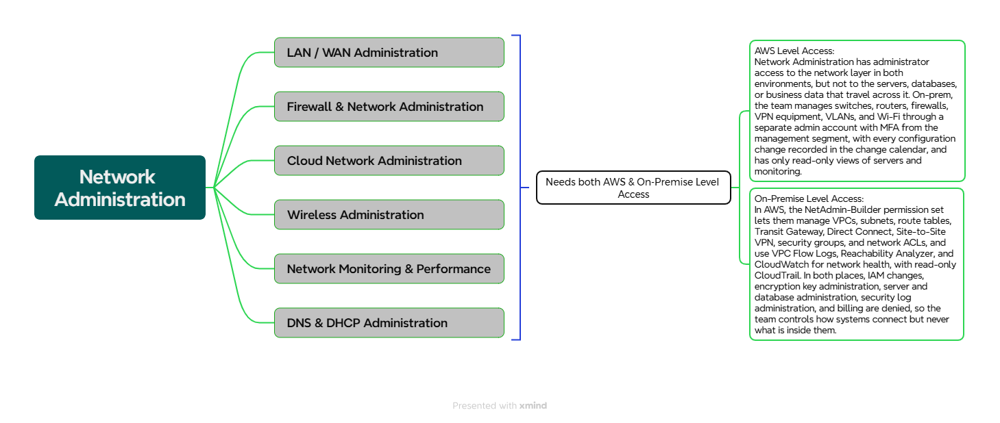

##  *Here is the workloads associated with the IT-Network Administration Field!*


<p align="center">
  
</p>


### *ACCESS PROFILES / PERMISSION SETS:*

| Field | Details | 
| --- | --- | 
| Team | Network Administration (IT Administration) |
| Purpose |	Design, build, and maintain the network that connects the New York data centers, offices, and AWS, without access to servers or business data |
| Applications and level |	Network device management tools (administrator), network monitoring (full), firewall management console (administrator), ticketing and change calendar (full), monitoring platform (read-only), SIEM (read-only) |
| Network devices (on-prem) |	Administrator rights on switches, routers, firewalls, VPN gateways, and wireless controllers: configure, upgrade, and troubleshoot. Every configuration change is recorded in the change calendar. |
| Servers and databases (on-prem) |	No administrator rights. Read-only views of server and monitoring status only. |
| Active Directory |	Delegated tasks only: membership of their own network groups. No Domain Admin. |
| File shares |	IT and network folders only (network diagrams, IP plan, route tables, firewall rule records, runbooks). No business file shares. |
| DNS and DHCP | Manage on-prem  DNS and DHCP services and Route 53 resolver rules. Route 53 records for company zones only if the client’s brief assigns them. |
| AWS Permission Set |	NetAdmin-Builder: VPC, subnets, route tables, internet and NAT gateways, Transit Gateway, Direct Connect, Site-to-Site VPN, security groups, network ACLs, VPC Flow Logs, Reachability Analyzer, CloudWatch, read-only CloudTrail |
| AWS account scope |	Network account: full builder rights. Dev: full network rights. Production, client-facing, and corporate: same permission set, with changes only through the change process. Shared services: resolver and connectivity tooling. No access to security/log archive, management, or billing accounts. |
| Data access |	None to business data. They manage how traffic flows, not what it contains. | 
| Explicitly denied	| IAM changes, KMS key administration, business data, server and database administration (EC2 administration, RDS, S3 object reads), security log administration, billing, Domain Admin |
| Network path | 	Management segment through the jump host (on-prem) and IAM Identity Center sign-in to the AWS console (AWS) |
| Authentication |	Separate admin account with MFA. AWS sign-in through IAM Identity Center with AD credentials. | 
| Privileged access	| Break-glass account: time-limited, logged, and alerted when used |
| Change control | Firewall, routing, and Direct Connect/VPN changes require an approved ticket, with emergency changes reviewed afterward |
| Logging and audit |	Device configuration changes logged on-prem and sent to the SIEM, CloudTrail and VPC Flow Logs in AWS | 
| Status | Draft, pending client confirmation of the workload list and of the split between Network and Security Administration | 


## Identity and Access Design: Network Administration

### 1. Purpose
Define how the Network Administration team signs in and what it can do on-premises and in AWS, so the team can design, build, and maintain the network connecting the data centers, offices, and AWS without access to servers or business data.

### 2. Client Requirements
| # | Requirement |
|---|---|
| R1 | Staff use their existing login. No separate AWS passwords. |
| R2 | Network administrators control how systems connect but cannot read payroll, HR, or background check data, and cannot administer servers or databases. |
| R3 | Each person gets only what their job needs (least privilege). |
| R4 | Administrative access requires a second verification step (MFA). |
| R5 | Every network change is recorded and traceable to a person. |
| R6 | Disabling one account removes access everywhere. |
| R7 | Firewall, routing, and Direct Connect/VPN changes require an approved change ticket. |
| R8 | Network administrators cannot alter or delete their own audit trail. |

### 3. Design Decisions
| Layer | Component | Role |
|---|---|---|
| Identity source | **Active Directory** | Holds user accounts and groups |
| AWS sign-in | **IAM Identity Center** | Syncs from AD and assigns access to AWS accounts |
| AWS permissions | **Permission set `NetAdmin-Builder`** | Defines what the team can build and change in the AWS network |

### 4. Access Flow
```
Network administrator (separate admin account + MFA)
        |
AD group: NetAdmin-Builders
        |
IAM Identity Center (assignment)
        |
Permission set: NetAdmin-Builder
        |
AWS accounts: Network (full builder) | Dev (full) | Production, Client-facing, Corporate (change process) | Shared services (resolver and connectivity tooling)
```

### 5. Group-to-Access Mapping
| AD Group | Permission Set / Rights | Scope |
|---|---|---|
| NetAdmin-Builders | `NetAdmin-Builder` | AWS: Network, Dev, Production, Client-facing, Corporate, Shared services |
| NetAdmin-Builders | Administrator on network devices | On-prem switches, routers, firewalls, VPN gateways, wireless controllers, through the jump host |

### 6. Permission Set: NetAdmin-Builder
**Allowed:** VPC, subnets, route tables, internet and NAT gateways, Transit Gateway, Direct Connect, Site-to-Site VPN, security groups, network ACLs, Route 53 resolver rules, VPC Flow Logs, Reachability Analyzer, CloudWatch, read-only CloudTrail.

**Denied:** IAM changes, KMS key administration, EC2 administration, RDS and S3 data access, security log administration, billing, security/log archive account, management account.

### 7. On-Premises Access
| Area | Access |
|---|---|
| Switches, routers, firewalls, VPN gateways, wireless controllers | Administrator: configure, upgrade, troubleshoot |
| Network device management tools, firewall console | Administrator |
| Network monitoring, ticketing, change calendar | Full |
| Monitoring platform, SIEM | Read-only |
| DNS and DHCP | Manage on-prem services and Route 53 resolver rules. Company zone records only if assigned by the client's brief. |
| Active Directory | Delegated: membership of their own network groups. No Domain Admin. |
| Servers and databases | No administrator rights. Read-only status views only. |
| Business file shares and data | Denied |
| Remote access | Jump host on the management segment |

### 8. Security Controls
- Separate admin account for privileged work (for example `adm-username`)
- MFA on admin accounts and on IAM Identity Center
- No direct device administration from regular desktops. Jump host on-prem, IAM Identity Center sign-in in AWS.
- Firewall, routing, and Direct Connect/VPN changes only through an approved change ticket. Emergency changes are reviewed afterward.
- Configuration backups of network devices, with changes compared against the approved baseline
- Device configuration logs and AWS audit logs sent to storage that this team cannot edit or delete
- Break-glass account: time-limited, logged, and alerts when used
- Separation of duties: Network Administration owns paths and traffic rules, System and Server Administration owns servers, Database Administration owns databases, and security owns identity, keys, and logs

### 9. Audit and Logging
| Environment | Record |
|---|---|
| AWS | CloudTrail (read-only to this team), VPC Flow Logs, AWS Config rule history for security groups and route tables |
| On-premises | Device configuration change logs sent to the SIEM, privileged session logs |
| Change control | Ticket, approver, change description, time, and rollback plan for every firewall and routing change |

### 10. Requirements Traceability
| Requirement | Met by |
|---|---|
| R1, R6 | AD as identity source, synced to IAM Identity Center |
| R2 | No data, EC2, RDS, S3, IAM, or KMS permissions in `NetAdmin-Builder`. No server or database rights on-prem. |
| R3 | Access assigned by group, scoped per account |
| R4 | MFA plus separate admin accounts |
| R5 | CloudTrail, VPC Flow Logs, device configuration logs, SIEM, change tickets |
| R7 | Approved change ticket required for firewall, routing, and Direct Connect/VPN changes, tracked in the change calendar |
| R8 | Logs stored in the security/log archive account and the SIEM, outside this team's permissions |

### 11. Assumptions and Open Items
- AD group names and account scope to be confirmed with the client
- Final workload list for Network Administration to be confirmed
- Split between Network Administration and Security Administration to be confirmed (assumed separate)
- Ownership of Route 53 company zone records to be decided (network team or another team)
- Network and firewall platforms in use to be confirmed with the client
- Exact IAM policy actions for `NetAdmin-Builder` to be documented in the build guide


