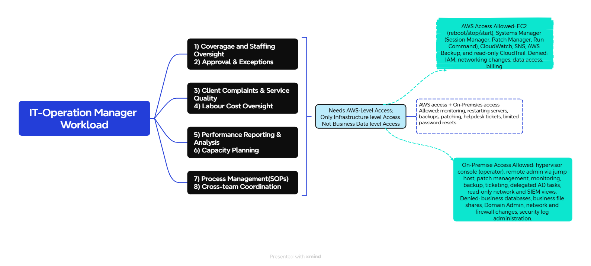

##  *Here is the workloads associated with the IT-Operation-Management Field!*


<p align="center">
  
</p>


The current scope of IT-Operation Management Field where mostly its workload and data lives is on On-Premsie \
and the owner wants to migrate it to the AWS now!


### *ACCESS PROFILES / PERMISSION SETS:*


| Field | Details | 
| --- | --- | 
| Team | IT Operations Management (part of IT Administration) |
| Purpose | Keep servers and platforms running, monitored, backed up, patched without having access to business data. |
| Application & Level | Hypervisor console (operator), monitoring platform (full), backup software (operator), patch management (operator), ticketing/helpdesk (full), change calendar (full), SIEM (read-only), network monitoring (read-only) |
| Active Directory | Delegated tasks only: password resets, account unlocks, assigned group membership. No Domain Admin. |
| File Shares | 	IT and operations folders only (runbooks, SOPs, change records). No business file shares. |
| Database Access | 	None to business databases (payroll, HR, background checks). Database servers can be restarted and backed up, but not queried. |
| AWS Permission Sets | ITOps-Operator: EC2 reboot/stop/start, Systems Manager (Session Manager, Patch Manager, Run Command), CloudWatch, SNS, AWS Backup, read-only CloudTrail |
| AWS Account Scope | Monitoring/shared services account (read, dashboards, alarms). Operator role in production and dev. Monitoring view in client-facing, corporate, and network accounts. |
| Explicitly Denied | Business databases and file shares, Domain Admin, network and firewall changes, security log administration, IAM changes, billing, security/log archive account, management account |
| Network Path | 	Management segment, through the jump host (on-prem) and Session Manager (AWS). No direct access from regular desktops. |
| Authentication | 	Separate admin account (for example adm-username) with MFA. AWS sign-in through IAM Identity Center with AD credentials. |
| Privileged Access | Break-glass account for emergencies: time-limited, logged, and alerted when used |
| Scheduling Inputs | Blackout windows from the Operations Manager, recorded in the change calendar. No access to the scheduling and dispatch application. |
| Logging & Audit | Privileged sessions logged on-prem and in AWS (CloudTrail, Session Manager logs) | 
| Status | Pending, requires client informaion | 


## Identity and Access Design: IT Operations Management

### 1. Purpose
Define how the IT Operations Management team signs in and what it can do on-premises and in AWS, so the team can keep systems running without access to business data.

### 2. Client Requirements
| # | Requirement |
|---|---|
| R1 | Staff use their existing login. No separate AWS passwords. |
| R2 | IT can operate systems but cannot read payroll, HR, or background check data. |
| R3 | Each person gets only what their job needs (least privilege). |
| R4 | Administrative access requires a second verification step (MFA). |
| R5 | Every administrative action is recorded and traceable to a person. |
| R6 | Disabling one account removes access everywhere. |

### 3. Design Decisions
| Layer | Component | Role |
|---|---|---|
| Identity source | **Active Directory** | Holds user accounts and groups |
| AWS sign-in | **IAM Identity Center** | Syncs from AD and assigns access to AWS accounts |
| AWS permissions | **Permission set `ITOps-Operator`** | Defines what the team can do inside AWS |

### 4. Access Flow
```
Engineer (AD account + MFA)
        |
AD group: IT-Ops-Servers
        |
IAM Identity Center (assignment)
        |
Permission set: ITOps-Operator
        |
AWS accounts: Production, Dev (operator) | Monitoring, Client-facing, Corporate, Network (view)
```

### 5. Group-to-Access Mapping
| AD Group | Permission Set | AWS Accounts |
|---|---|---|
| IT-Ops-Servers | ITOps-Operator | Production, Dev |
| IT-Ops-Servers | Monitoring view (read-only) | Monitoring/shared services, Client-facing, Corporate, Network |

### 6. Permission Set: ITOps-Operator
**Allowed:** EC2 reboot/stop/start, Systems Manager (Session Manager, Patch Manager, Run Command), CloudWatch, SNS, AWS Backup, read-only CloudTrail.

**Denied:** IAM changes, network changes (VPC, routing, security groups, VPN), access to business data (databases, S3), billing, security/log archive account, management account.

### 7. On-Premises Access
| Area | Access |
|---|---|
| Hypervisor, backup, patching | Operator |
| Monitoring, ticketing, change calendar | Full |
| SIEM, network monitoring | Read-only |
| Active Directory | Delegated tasks only (password resets, account unlocks, assigned group membership). No Domain Admin. |
| Business databases and file shares | Denied |
| Remote access | Jump host on the management segment |

### 8. Security Controls
- Separate admin account for privileged work (for example `adm-username`)
- MFA on admin accounts and on IAM Identity Center
- No direct SSH/RDP from regular desktops. Session Manager in AWS, jump host on-prem.
- Break-glass account: time-limited, logged, and alerts when used
- Separation of duties: IT Operations runs systems, security owns logs, network team owns network changes

### 9. Audit and Logging
| Environment | Record |
|---|---|
| AWS | CloudTrail (read-only to IT Operations), Session Manager session logs |
| On-premises | Privileged session logs, SIEM alerts |

### 10. Requirements Traceability
| Requirement | Met by |
|---|---|
| R1, R6 | AD as identity source, synced to IAM Identity Center |
| R2 | No data, IAM, or network permissions in `ITOps-Operator`. Business databases and shares denied on-prem. |
| R3 | Access assigned by group, scoped per account |
| R4 | MFA plus separate admin accounts |
| R5 | CloudTrail, Session Manager logs, on-prem session logs |

### 11. Assumptions and Open Items
- AD group names and account scope to be confirmed with the client
- Final workload list for IT Operations to be confirmed
- Exact IAM policy actions for `ITOps-Operator` to be documented in the build guide


