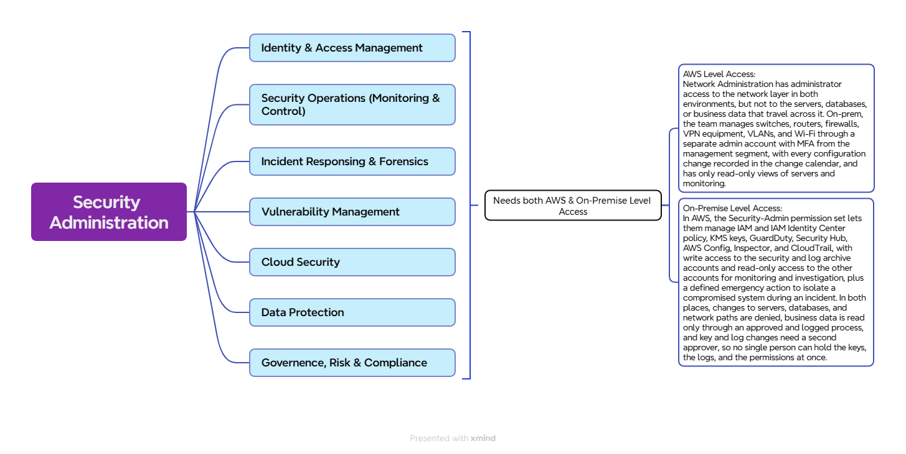
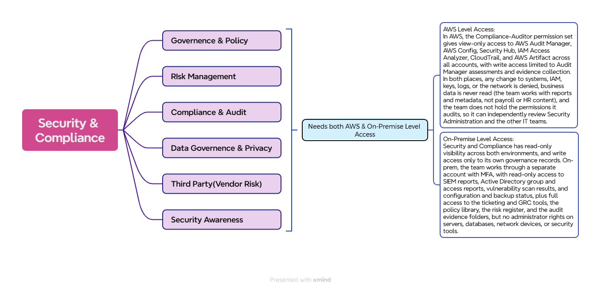

##  *Here is the workloads associated with the IT-Database Administration Field!*


<p align="center">
  
</p>

### *ACCESS PROFILES / PERMISSION SETS:*
| Field | Details |
| --- | --- | 
| Team |	Security Administration (IT Administration) |
| Purpose |	Protect systems and data, control who gets access, own keys and security logs, monitor for threats, and respond to incidents |
| Applications and level | SIEM (administrator), vulnerability scanner (administrator), endpoint and email security consoles (administrator), key management system (administrator, with second approver for changes), ticketing and change calendar (full), monitoring platform (read-only), network monitoring (read-only) |
| Active Directory |	Governance only: read access to AD logs, group memberships, and Group Policy settings for access reviews, Domain Admin approval, and monitoring. No day-to-day account administration and no Domain Admin. |
| Servers, databases, and network devices (on-prem)	| No administrator rights. Read-only views and log access for investigation. Isolation of a compromised system through a defined emergency action. | 
| File shares	| IT and security folders only (policies, access review records, incident reports, audit evidence). No business file shares. |
| Business data	| Not read by default. Reading is allowed only through an approved ticket, a time limit, and a logged session, for incident investigation. | 
| AWS Permission Set | Security-Admin: IAM and IAM Identity Center (policy management), KMS (key administration, second approver for changes), GuardDuty, Security Hub, AWS Config, Inspector, CloudTrail, Service Control Policies, read-only access to workload accounts |
| AWS account scope |	Security and log archive accounts: write access. Production, dev, client-facing, corporate, network, and shared services: read-only for monitoring and investigation. Management account: limited access for Service Control Policies and organization-level security settings. Billing: no access. | 
| Incident response access | Security-IncidentResponder (emergency, time-limited): isolate instances, take snapshots, and restrict access during an incident. Every use is alerted and reviewed. | 
| Explicitly denied	| Administering servers, databases, or network paths, routine reads of business data, billing, Domain Admin, day-to-day AD account administration, deleting or editing its own audit logs | 
| Network path |	Management segment through the jump host (on-prem) and IAM Identity Center sign-in to the AWS console (AWS) |  
| Authentication | Separate admin account with MFA. AWS sign-in through IAM Identity Center with AD credentials, using hardware-key MFA for key and log administration where the client supports it. | 
| Privileged access |	Break-glass account: time-limited, logged, and alerted when used. Reviewed by the client’s management, not by the security team alone. | 
| Two-person control | Changes to encryption keys, log retention, and log archive settings need a second approver. No single person holds the keys, the logs, and the permissions together. | 
| Logging and audit |	Security logs stored in the log archive account with write-once protection. Security team actions are also recorded in CloudTrail and the SIEM, with periodic review by the client’s management or an external auditor. | 
| Status | Draft, pending client confirmation of the workload list and of Active Directory ownership (assumed: run by System and Server Administration, governed by Security Administration) | 


## Identity and Access Design: Security Administration

### 1. Purpose
Define how the Security Administration team signs in and what it can do on-premises and in AWS, so the team can control access, own encryption keys and security logs, monitor for threats, and respond to incidents without administering servers, databases, or the network, and without routine access to business data.

### 2. Client Requirements
| # | Requirement |
|---|---|
| R1 | Staff use their existing login. No separate AWS passwords. |
| R2 | Security staff monitor and investigate but do not administer servers, databases, or network paths, and do not read payroll, HR, or background check data as part of routine work. |
| R3 | Each person gets only what their job needs (least privilege). |
| R4 | Administrative access requires a second verification step (MFA). |
| R5 | Every security administrative action is recorded and traceable to a person. |
| R6 | Disabling one account removes access everywhere. |
| R7 | Changes to encryption keys, log retention, and the log archive need a second approver. |
| R8 | Security logs are protected from deletion or editing, including by the security team. |
| R9 | Emergency access during an incident is time-limited, logged, and reviewed afterward. |
| R10 | Someone outside the security team periodically reviews what the security team did. |

### 3. Design Decisions
| Layer | Component | Role |
|---|---|---|
| Identity source | **Active Directory** | Holds user accounts and groups. Run by System and Server Administration, governed by Security Administration. |
| AWS sign-in | **IAM Identity Center** | Syncs from AD and assigns access to AWS accounts |
| AWS permissions | **Permission set `Security-Admin`** | Defines what the team can manage in AWS security services |
| Emergency access | **Permission set `Security-IncidentResponder`** | Time-limited containment actions during an incident |
| Second approval | **AD group `Security-KeyApprovers`** | Approves key and log changes made by another team member |

### 4. Access Flow
```
Security administrator (separate admin account + MFA)
        |
AD group: Security-Admins
        |
IAM Identity Center (assignment)
        |
Permission set: Security-Admin
        |
AWS accounts: Security and log archive (write) | Management (limited: SCPs and org security settings) | All workload accounts (read-only)
```

**Incident containment (time-limited):**
```
Declared incident ticket → temporary membership in Security-IncidentResponders → permission set Security-IncidentResponder → isolate, snapshot, restrict → automatic removal → alert and post-incident review
```

**Key and log changes (two-person control):**
```
Change requested by Security-Admins member → approved by a different member of Security-KeyApprovers → change applied → logged in CloudTrail and the SIEM
```

### 5. Group-to-Access Mapping
| AD Group | Permission Set / Rights | Scope |
|---|---|---|
| Security-Admins | `Security-Admin` | AWS: security and log archive (write), management (limited), all workload accounts (read-only) |
| Security-Admins | Administrator on security tools | On-prem SIEM, vulnerability scanner, endpoint and email security, key management system, through the jump host |
| Security-Admins | Read access to AD logs, group memberships, and Group Policy settings | On-prem Active Directory (governance only) |
| Security-IncidentResponders (temporary members) | `Security-IncidentResponder` | AWS workload accounts, for the duration of a declared incident |
| Security-KeyApprovers | Second approval on key and log changes | AWS KMS, log archive settings, on-prem key management |

### 6. Permission Sets
**`Security-Admin`**
- **Allowed:** IAM and IAM Identity Center (policy management), KMS (key administration, with second approver), GuardDuty, Security Hub, AWS Config, Inspector, CloudTrail, Service Control Policies, read-only access to workload accounts.
- **Denied:** EC2, RDS, and S3 administration, network changes (VPC, routing, VPN, Direct Connect), routine reads of business data, billing, deleting or editing log archive contents.

**`Security-IncidentResponder`** (emergency, time-limited)
- **Allowed:** isolate instances, take snapshots, restrict access, and read affected resources.
- **Denied:** permanent changes to servers, databases, and network, and everything denied to `Security-Admin`.

### 7. On-Premises Access
| Area | Access |
|---|---|
| SIEM, vulnerability scanner, endpoint and email security consoles | Administrator |
| Key management system | Administrator, with a second approver for changes |
| Ticketing and change calendar | Full |
| Monitoring platform, network monitoring | Read-only |
| Active Directory | Governance only: read access to logs, group memberships, and Group Policy. No account administration and no Domain Admin. |
| Servers, databases, network devices | No administrator rights. Read-only views and logs. Isolation of a compromised system through a defined emergency action. |
| Business file shares and data | Denied by default. Approved, time-limited access for incident investigation only. |
| Remote access | Jump host on the management segment |

### 8. Security Controls
- Separate admin account for privileged work (for example `adm-username`)
- MFA on admin accounts and on IAM Identity Center, with hardware-key MFA for key and log administration where supported
- No direct access to security tools from regular desktops. Jump host on-prem, IAM Identity Center sign-in in AWS.
- Two-person control: key changes, log retention, and log archive settings need a second approver
- Log archive account with write-once storage and no delete permission for any administrator, including security
- Service Control Policies prevent anyone from disabling CloudTrail, GuardDuty, or the log archive
- Domain Admin membership approved by Security Administration, with every use alerted in the SIEM
- Quarterly access reviews of AD groups and AWS assignments
- Incident access (`Security-IncidentResponder`) granted only against a declared incident ticket, removed automatically, and reviewed afterward
- Break-glass account: time-limited, logged, alerts when used, and reviewed by the client's management rather than by the security team alone
- Separation of duties: Security Administration owns identity policy, keys, and logs. System and Server Administration, Database Administration, and Network Administration own their systems. IT Operations runs them.

### 9. Audit and Logging
| Environment | Record |
|---|---|
| AWS | CloudTrail organization trail stored in the log archive account, AWS Config history, GuardDuty and Security Hub findings, Session Manager logs |
| On-premises | SIEM records of security tool administration, key management logs, AD audit logs, privileged session logs |
| Key and log changes | Ticket, requester, approver, time, and change description |
| Review of the security team | Quarterly review of security administrative activity by the client's management or an external auditor |

### 10. Requirements Traceability
| Requirement | Met by |
|---|---|
| R1, R6 | AD as identity source, synced to IAM Identity Center |
| R2 | No EC2, RDS, S3, or network permissions in `Security-Admin`. No administrator rights on servers, databases, or network devices on-prem. Business data read only through an approved, logged process. |
| R3 | Access assigned by group, scoped per account, read-only in workload accounts |
| R4 | MFA plus separate admin accounts, with hardware keys for key and log administration |
| R5 | CloudTrail, SIEM, key management logs, AD audit logs |
| R7 | `Security-KeyApprovers` group, with a different person approving each key and log change |
| R8 | Log archive account with write-once storage, SCPs blocking log tampering |
| R9 | `Security-IncidentResponder` tied to an incident ticket, auto-removed, alerted, and reviewed |
| R10 | Quarterly review by the client's management or an external auditor |

### 11. Assumptions and Open Items
- AD group names and account scope to be confirmed with the client
- Final workload list for Security Administration to be confirmed
- Active Directory ownership assumed as: run by System and Server Administration, governed by Security Administration
- Number of security staff to be confirmed. Two-person control needs at least two people able to approve each other's changes, so a one-person security function would need an outside approver.
- Whether monitoring (security operations) is outsourced to be confirmed
- Who performs the periodic review of the security team (client management or external auditor) to be decided by the client
- Exact IAM policy actions for `Security-Admin` and `Security-IncidentResponder` to be documented in the build guide


## *SECURITY & COMPLIANCE:*

<p align="center">
  
</p>


### *Permission Sets:*


| | AWS	| On-prem |
| --- | --- | --- | 
| Access | `Compliance-Auditor` permission set: view-only in all accounts to Audit Manager, AWS Config, Security Hub, IAM Access Analyzer, CloudTrail, and Artifact	| Read-only access to SIEM reports, Active Directory group and access reports, vulnerability scan results, and configuration, patch, and backup status reports |
| Can write to | Audit Manager assessments and evidence collection only |	GRC and ticketing tools, the policy library, the risk register, and the audit evidence folders |
| Denied | Changes to systems, IAM, keys, logs, or security tools, business data, billing	| Administrator rights on servers, databases, network devices, and security tools, Domain Admin, business data and business file shares | 
| How they sign in | IAM Identity Center with AD credentials and MFA	| A separate admin account with MFA, through the jump host for tool and report access | 
| AD group | `Compliance-Auditors` |	`Compliance-Auditors` | 


