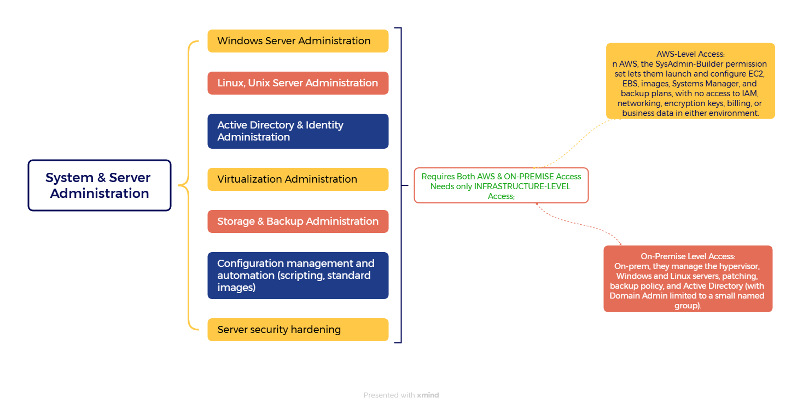

##  *Here is the workloads associated with the IT-System & Server Administration field!*


<p align="center">
  
</p>


The current scope of IT-System & Server Administration Field where mostly its workload and data lives is on On-Premsie \
and the owner wants to migrate it to the AWS now!

### *ACCESS PROFILES / PERMISSION SETS:*


| Field | Details | 
| --- | --- | 
| Team | System and Server Administration (IT Administration) | 
| Purpose	| Build, configure, secure, and maintain servers and operating systems, on-prem and in AWS, without access to business data |
| Applications and level |	Hypervisor (administrator), server management tools (full), patch management (administrator), backup software (administrator), monitoring (full), ticketing and change calendar (full), SIEM (read-only), network monitoring (read-only) |
| Active Directory | Owns AD administration (users, groups, Group Policy, domain controllers). Domain Admin limited to a small named group (two or three people) using a separate privileged account. |
| File shares |	Manage file servers (capacity, structure, share permissions), with full access to IT folders. No access to business content.
| Database access |	OS-level administration of database servers only. No querying of business databases. |
| AWS Permission Set |	`SysAdmin-Builder`: EC2, EBS, AMIs and launch templates, Systems Manager (full), CloudWatch, AWS Backup plans, read-only CloudTrail |
| AWS account scope	| Dev (full builder rights). Production, client-facing, and corporate (same permission set, changes only through the change process). Shared services (Systems Manager and images). No access to network, security/log archive, management, or billing accounts. | 
| Explicitly denied	| Business data (payroll, HR, background checks), network and firewall changes, security log administration, IAM changes, KMS key administration, billing | 
| Network path |	Management segment through the jump host (on-prem) and Session Manager (AWS) | 
| Authentication | Separate admin account with MFA. AWS sign-in through IAM Identity Center with AD credentials. |
| Privileged access | Break-glass account: time-limited, logged, and alerted when used |
| Logging and audit	| Privileged sessions logged, Domain Admin use alerted in the SIEM, CloudTrail and Session Manager logs in AWS | 
| Status | Draft, pending client confirmation of the workload list |


## Identity and Access Design: System and Server Administration

### 1. Purpose
Define how the System and Server Administration team signs in and what it can do on-premises and in AWS, so the team can build and maintain servers without access to business data.

### 2. Client Requirements
| # | Requirement |
|---|---|
| R1 | Staff use their existing login. No separate AWS passwords. |
| R2 | Server administrators can build and configure systems but cannot read payroll, HR, or background check data. |
| R3 | Each person gets only what their job needs (least privilege). |
| R4 | Administrative access requires a second verification step (MFA). |
| R5 | Every administrative action is recorded and traceable to a person. |
| R6 | Disabling one account removes access everywhere. |
| R7 | Highest-level rights (Domain Admin) are limited to a small named group. |
| R8 | Production changes follow an approved change process. |

### 3. Design Decisions
| Layer | Component | Role |
|---|---|---|
| Identity source | **Active Directory** | Holds user accounts and groups, administered by this team |
| AWS sign-in | **IAM Identity Center** | Syncs from AD and assigns access to AWS accounts |
| AWS permissions | **Permission set `SysAdmin-Builder`** | Defines what the team can build and configure in AWS |

### 4. Access Flow
```
Administrator (separate admin account + MFA)
        |
AD group: SysAdmin-Builders
        |
IAM Identity Center (assignment)
        |
Permission set: SysAdmin-Builder
        |
AWS accounts: Dev (full builder) | Production, Client-facing, Corporate (change process) | Shared services (Systems Manager, images)
```

### 5. Group-to-Access Mapping
| AD Group | Permission Set | AWS Accounts |
|---|---|---|
| SysAdmin-Builders | SysAdmin-Builder | Dev, Production, Client-facing, Corporate, Shared services |
| SysAdmin-DomainAdmins (two or three named people) | Domain Admin (on-prem only) | Active Directory domain |

### 6. Permission Set: SysAdmin-Builder
**Allowed:** EC2 (launch, modify, stop, start, terminate), EBS volumes and snapshots, AMIs and launch templates, Systems Manager (full), CloudWatch, AWS Backup (plans and policies), limited server-level secrets, read-only CloudTrail.

**Denied:** IAM changes, network changes (VPC, routing, security groups, VPN/Direct Connect), S3 and RDS data access, KMS key administration, billing, security/log archive account, management account, network account.

### 7. On-Premises Access
| Area | Access |
|---|---|
| Hypervisor, patch management, backup software | Administrator |
| Windows and Linux servers | Local administrator through the jump host only |
| Monitoring, ticketing, change calendar | Full |
| SIEM, network monitoring | Read-only |
| Active Directory | Owner of administration. Domain Admin limited to a small named group using a separate privileged account. |
| File servers | Manage capacity, structure, and share permissions. No access to business content. |
| Database servers | OS-level administration only. No querying of business databases. |
| Remote access | Jump host on the management segment |

### 8. Security Controls
- Separate admin account for privileged work (for example `adm-username`)
- MFA on admin accounts and on IAM Identity Center
- No direct SSH/RDP from regular desktops. Session Manager in AWS, jump host on-prem.
- Domain Admin accounts used only when required, and alerted in the SIEM on every use
- Break-glass account: time-limited, logged, and alerts when used
- Production changes only through an approved change ticket
- Encryption keys (KMS) controlled by security, so administrators manage storage but cannot decrypt business data
- Separation of duties: System and Server Administration builds systems, IT Operations runs them, security owns logs and keys, and the network team owns network changes

### 9. Audit and Logging
| Environment | Record |
|---|---|
| AWS | CloudTrail (read-only to this team), Session Manager session logs |
| On-premises | Privileged session logs, SIEM alerts on Domain Admin use and sensitive share access |

### 10. Requirements Traceability
| Requirement | Met by |
|---|---|
| R1, R6 | AD as identity source, synced to IAM Identity Center |
| R2 | No data, IAM, network, or KMS permissions in `SysAdmin-Builder`. Business databases and shares denied on-prem. Encryption keys held by security. |
| R3 | Access assigned by group, scoped per account |
| R4 | MFA plus separate admin accounts |
| R5 | CloudTrail, Session Manager logs, on-prem session logs, SIEM alerts |
| R7 | Separate `SysAdmin-DomainAdmins` group with two or three named people |
| R8 | Change ticket required for production, tracked in the change calendar |

### 11. Assumptions and Open Items
- AD group names and account scope to be confirmed with the client
- Final workload list for System and Server Administration to be confirmed
- Named Domain Admin members to be decided by the client
- Exact IAM policy actions for `SysAdmin-Builder` to be documented in the build guide


