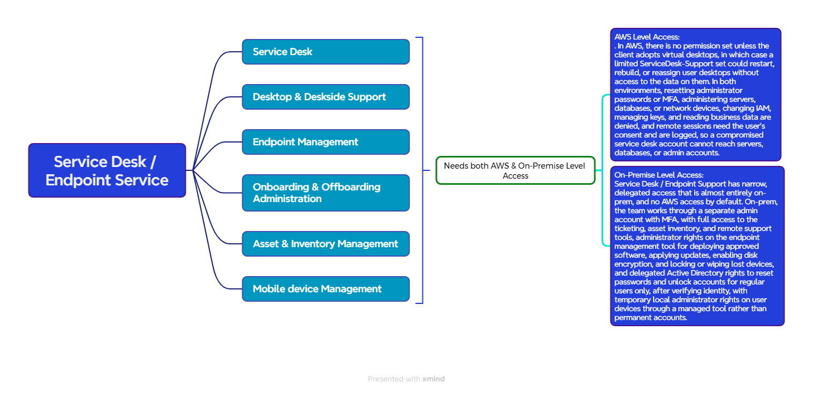

##  *Here is the workloads associated with the IT-Service Desk Endpoint Support!*


<p align="center">
  
</p>

### *ACCESS PROFILES / PERMISSION SETS:*


| Field | Details |
|---|---|
| **Team** | Service Desk / Endpoint Support (IT Administration) |
| **Purpose** | Support users and their devices: tickets, password resets, device setup, software deployment, and lost device handling, without access to servers, databases, admin accounts, or business data |
| **Applications and level** | Ticketing and service desk tool (full), asset inventory (full), remote support tool (operator), endpoint management tool such as Intune or SCCM (administrator for devices), knowledge base (full), monitoring platform (read-only) |
| **Endpoint management** | Deploy approved software and updates, apply device settings, enable disk encryption, lock or wipe lost devices, and manage the device inventory. Cannot change security baselines or the tool's global policies. |
| **Active Directory** | Delegated tasks only: reset passwords and unlock accounts for **standard user accounts**, after identity verification. Cannot reset or unlock administrator accounts or members of privileged groups. No group administration beyond assigned user groups. No Domain Admin. |
| **MFA reset** | Not allowed for administrator accounts. For standard users, only after strong identity verification (for example, a call-back to the employee's manager or HR). |
| **Local administrator on user devices** | No permanent rights. Temporary local administrator access through a managed tool (for example LAPS), with a unique password per device, time-limited and logged. |
| **Remote support** | Connect to a user's device with the user's consent. Sessions are logged. |
| **File shares** | IT and support folders only (knowledge base, setup guides, asset records). No business file shares. |
| **Business data** | Never read. They fix the device, not the files on it. |
| **AWS Permission Set** | None by default. If the client adopts AWS WorkSpaces or AppStream, a limited `ServiceDesk-Support` set could restart, rebuild, or reassign user desktops, with no access to the data on them. |
| **AWS account scope** | None by default. If virtual desktops are adopted: the end-user computing account only. No access to workload, network, security/log archive, management, or billing accounts. |
| **Explicitly denied** | Resetting administrator passwords or MFA, administering servers, databases, or network devices, changing IAM, managing keys, reading business data, security tool administration, Domain Admin, billing |
| **Escalation** | Server, network, database, and security problems are passed to the owning team through the ticketing tool, not fixed by Service Desk |
| **Network path** | Corporate network through AD, with remote support through the approved remote support tool. Admin tool access from the management segment through the jump host. |
| **Authentication** | Separate admin account for endpoint management and AD delegation, with MFA. Standard account for everyday work. |
| **Privileged access** | No standing privileged access. Break-glass not required for this team. |
| **Logging and audit** | Password resets, MFA resets, remote sessions, local admin requests, and device wipes are logged with the agent, user, and time, and sent to the SIEM for review |
| **Status** | Draft, pending client confirmation of device types, remote support tool, and whether virtual desktops are used |

## Identity and Access Design: Service Desk / Endpoint Support

### 1. Purpose
Define how the Service Desk / Endpoint Support team signs in and what it can do, so the team can support users and manage their devices without being able to reach servers, databases, administrator accounts, or business data.

### 2. Client Requirements
| # | Requirement |
|---|---|
| R1 | Staff use their existing login. No separate passwords for support tools. |
| R2 | Service desk staff fix devices and accounts but cannot read payroll, HR, or background check data. |
| R3 | Each person gets only what their job needs (least privilege). |
| R4 | Administrative access requires a second verification step (MFA). |
| R5 | Every password reset, MFA reset, remote session, and device wipe is recorded and traceable to a person. |
| R6 | Disabling one account removes access everywhere. |
| R7 | Service desk cannot reset or unlock administrator accounts or members of privileged groups. |
| R8 | A caller's identity is verified before any password or MFA reset. |
| R9 | Users do not hold permanent local administrator rights. Support gets temporary, logged administrator access when needed. |
| R10 | Remote support sessions need the user's consent and are logged. |

### 3. Design Decisions
| Layer | Component | Role |
|---|---|---|
| Identity source | **Active Directory** | Holds user accounts and groups, with delegated rights for the service desk |
| Device management | **Endpoint management tool** (for example Intune or SCCM) | Deploys software and settings, and locks or wipes devices |
| Local administrator control | **Managed local admin password tool** (for example LAPS) | Gives temporary, per-device administrator access |
| AWS sign-in | **IAM Identity Center** | Not used by this team by default. Added only if the client adopts virtual desktops. |
| AWS permissions | **None by default** | Optional `ServiceDesk-Support` permission set if AWS WorkSpaces or AppStream is adopted |

### 4. Access Flow
```
Service desk agent (separate admin account + MFA)
        |
AD group: ServiceDesk-Agents or ServiceDesk-EndpointAdmins
        |
Delegated AD rights and endpoint management roles
        |
Standard user accounts and managed devices
(administrator accounts and privileged groups excluded)
```

**Password reset (standard user):**
```
Caller contacts service desk → identity verified → password reset on a standard account → logged with agent, user, and time → forwarded to the SIEM
```

**Temporary local administrator access:**
```
Support request → agent requests local admin through the managed tool → time-limited unique password issued for that device → expires automatically → logged
```

**Optional (virtual desktops only):**
```
AD group: ServiceDesk-Agents → IAM Identity Center → permission set: ServiceDesk-Support → end-user computing account
```

### 5. Group-to-Access Mapping
| AD Group | Rights | Scope |
|---|---|---|
| ServiceDesk-Agents | Ticketing (full), remote support (operator), delegated password reset and unlock for standard users | On-prem: ticketing tool, remote support tool, Active Directory (standard users only) |
| ServiceDesk-EndpointAdmins | Endpoint management (administrator for devices), asset inventory, temporary local admin requests, lost device lock or wipe | On-prem: endpoint management tool, managed devices |
| ServiceDesk-Agents (optional) | `ServiceDesk-Support` | AWS: end-user computing account only, if virtual desktops are adopted |

### 6. Permission Set: ServiceDesk-Support (optional)
Used only if the client adopts AWS WorkSpaces or AppStream.

**Allowed:** restart, rebuild, and reassign user desktops, and view desktop status.

**Denied:** access to data on user desktops, IAM changes, network changes, EC2, RDS, and S3 administration, KMS key administration, billing, security/log archive account, management account, and all workload accounts.

### 7. On-Premises Access
| Area | Access |
|---|---|
| Ticketing and service desk tool, asset inventory, knowledge base | Full |
| Remote support tool | Operator: connect with the user's consent, sessions logged |
| Endpoint management tool | Administrator for devices: deploy approved software and updates, apply device settings, enable disk


